# 智慧自习室预约与管理系统

## 需求规格说明书

| 项目 | 内容 |
|---|---|
| 文档名称 | 智慧自习室预约与管理系统 需求规格说明书 |
| 文档编号 | SRS-ZXSS-V1.4 |
| 文档版本 | V1.4 |
| 文档状态 | 需求基线（V1.4；组内教学模拟决定已回填，关键参数仍待真实业务确认） |
| 编写人 | 杨子涵（246003384） |
| 编写日期 | 2026-10-15 |
| 适用课程 | 软件工程 |
| 项目类型 | 熟悉业务系统项目 |
| 小组编号／名称 | 鱿鱼子涵 |
| 小组成员 | 应雨挺（组长）、方与皓、周俊楠、杨子涵 |
| 存放位置 | 软件工程/智慧自习室预约与管理系统-需求规格说明书.md |

### 文档修订记录

| 版本 | 日期 | 修订人 | 修订说明 |
|---|---|---|---|
| V0.1 | 2026-10-15 | 小组合作修订 | 依据实践项目说明建立需求框架，梳理功能清单与状态模型 |
| V1.0 | 2026-10-15 | 小组合作修订 | 补齐业务规则、权限矩阵、数据字典、质量要求与可追溯矩阵，形成首个需求基线草案 |
| V1.1 | 2026-10-15 | 小组合作修订 | 修订编号引用错误与涉众编号冲突；补充账号锁定状态、违约申诉状态模型、七则用例描述、三项权限操作与一批待确认参数；消除 SC 编号越界并统一时限口径；新增目录与图表清单 |
| V1.2 | 2026-10-15 | 小组合作修订 | 补齐封面小组信息；补写 UC-01、UC-02、UC-09、UC-12、UC-14、UC-16、UC-17 七则用例描述；调整权限矩阵操作行顺序；同步 md/docx/pdf 三版 |
| V1.3 | 2026-10-29 | 小组合作修订 | 补充 2026-10-29 教学模拟确认结论（T-01—T-08）；将受影响的 15 项参数确认状态更新为「教学模拟已确认」；附录 B 新增 B.1 教学模拟确认结论；同步 md/docx/pdf（同日补遗：Q-01／Q-09 执行口径、Q-17 寒暑假口径、E-07 签名页） |
| V1.4 | 2026-11-12 | 小组合作修订 | 同步 2026-11-12 组内教学模拟架构阶段决定：范围收窄与后续标注、口径修订、附录 B 更新 Q-01—Q-22 处理方式并新增 B.2（Q-23—Q-47）；AC 编号与 68 条总数不变；md/docx/pdf 同步。 |

### 目录

- **编号与标注约定** —— 编号规则、来源性质、确认状态
- **1 引言** —— 1.1 编写目的；1.2 项目背景；1.3 读者对象；1.4 术语与缩略语；1.5 编号与标注约定
- **2 业务目标与系统范围** —— 2.1 业务目标；2.2 成功指标；2.3 系统范围；2.4 系统上下文
- **3 涉众与用户角色** —— 3.1 涉众；3.2 用户角色
- **4 功能需求** —— 4.1 FR-01 登录与身份认证；4.2 FR-02 自习室与座位资源管理；4.3 FR-03 预约管理；4.4 FR-04 取消预约、签到与签退；4.5 FR-05 自动违约记录与申诉；4.6 FR-06 查询；4.7 FR-07 管理员实时座位管理与手动违约登记；4.8 FR-08 用户信息管理与评价管理；4.9 FR-09 投诉管理与反馈；4.10 FR-10 黑名单管理；4.11 FR-11 数据分析与可视化；4.12 FR-12 通知与提醒；4.13 FR-13 开放时间与规则参数配置；4.14 FR-14 审计日志
- **5 用户故事与用例** —— 5.1 用户故事；5.2 用例图；5.3 用例清单；5.4 核心用例描述
- **6 业务规则** —— BR-01 至 BR-25
- **7 状态模型** —— 7.1 SM-01 座位状态；7.2 SM-02 预约单状态；7.3 SM-03 用户账号状态；7.4 SM-04 投诉单状态；7.5 SM-05 违约记录状态
- **8 活动流程** —— 8.1 AD-01 座位预约主流程；8.2 AD-02 签到与签退流程；8.3 AD-03 自动违约处理流程；8.4 AD-04 投诉处理流程
- **9 数据需求** —— 9.1 领域类图；9.2 数据字典；9.3 关键数据关系与状态对应
- **10 权限矩阵**
- **11 质量要求（非功能需求）** —— NFR-01 至 NFR-18
- **12 异常场景** —— EX-01 至 EX-13
- **13 验收标准** —— 13.1 账号与访问；13.2 资源管理；13.3 预约；13.4 使用过程；13.5 违约与信用；13.6 查询；13.7 管理员实时管理；13.8 评价；13.9 投诉；13.10 黑名单；13.11 数据分析；13.12 通知、参数与日志
- **14 需求有效性验证、可追溯矩阵与需求基线** —— 14.1 可追溯矩阵；14.2 覆盖检查；14.3 需求基线
- **附录 A 待确认参数清单** —— P-01 至 P-28
- **附录 B 不确定问题与需业务方确认清单** —— Q-01 至 Q-22；B.1 教学模拟确认结论（2026-10-29）；B.2 架构阶段决策（2026-11-12）
- **附录 C 编号索引**

### 图清单

| 图编号 | 图名称 | 建模对象 | 所在章节 | 源文件 |
|---|---|---|---|---|
| GT-01 | 目标树 | 业务目标体系 | 2.1 | figures/GT-01-目标树.mmd |
| CM-01 | 系统上下文图 | 系统边界与外部交互 | 2.4 | figures/CM-01-系统上下文图.mmd |
| UCD-01 | 用例图 | 功能与参与者的关系 | 5.2 | figures/UCD-01-用例图.mmd |
| SM-01 | 座位状态图 | 座位 | 7.1 | figures/SM-01-座位状态.mmd |
| SM-02 | 预约单状态图 | 预约单 | 7.2 | figures/SM-02-预约单状态.mmd |
| SM-03 | 用户账号状态图 | 学生账号 | 7.3 | figures/SM-03-账号状态.mmd |
| SM-04 | 投诉单状态图 | 投诉单 | 7.4 | figures/SM-04-投诉单状态.mmd |
| SM-05 | 违约记录状态图 | 违约记录 | 7.5 | figures/SM-05-违约记录状态.mmd |
| AD-01 | 座位预约主流程 | 预约业务流程 | 8.1 | figures/AD-01-预约主流程.mmd |
| AD-02 | 签到与签退流程 | 使用过程流程 | 8.2 | figures/AD-02-签到签退.mmd |
| AD-03 | 自动违约处理流程 | 违约与黑名单流程 | 8.3 | figures/AD-03-自动违约处理.mmd |
| AD-04 | 投诉处理流程 | 投诉处理流程 | 8.4 | figures/AD-04-投诉处理.mmd |
| CD-01 | 领域类图 | 领域实体及其关联 | 9.1 | figures/CD-01-领域类图.mmd |

图模型的可编辑源文件为 `.mmd`，清晰导出版本为同名 `.svg` 与 `.png`，三者内容一致。

### 表清单

SRS 中的表格不单独编号，按所在章节引用；下表列出各章的主要表格。

| 表名称 | 所在章节 |
|---|---|
| 文档信息、文档修订记录、编制依据 | 封面 |
| 编号规则、来源性质、确认状态 | 编号与标注约定 |
| 读者对象、术语与缩略语 | 1.3、1.4 |
| 业务目标、成功指标、范围外清单、系统上下文 | 2.1—2.4 |
| 涉众、用户角色 | 3.1、3.2 |
| 功能需求表（FR-01 至 FR-14） | 4.1—4.14 |
| 用户故事表、用例清单、核心用例描述中的主流程与备选流表 | 5.1、5.3、5.4 |
| 业务规则表 | 6 |
| 状态转换说明表（SM-01 至 SM-05） | 7.1—7.5 |
| 数据字典、关键数据关系与状态对应 | 9.2、9.3 |
| 权限矩阵 | 10 |
| 质量要求表 | 11 |
| 异常场景表 | 12 |
| 验收标准表（13.1 至 13.12） | 13 |
| 可追溯矩阵、覆盖检查表、需求基线表 | 14.1—14.3 |
| 待确认参数清单、不确定问题清单、编号索引 | 附录 A—附录 C |

### 编制依据

| 编号 | 材料名称 | 版本 / 位置 |
|---|---|---|
| REF-01 | 实践项目说明（九、贯穿式课程项目设计） | 实践项目说明.pdf，第 1—3 页 |
| REF-02 | 学生需求分析与 AI 智能体使用验证报告 | 学生需求分析与AI智能体使用验证报告.md |
| REF-03 | 编程智能体辅助下的软件工程开发环境安装、配置与操作实验手册（学生版） | 同目录 .md 文件 |
| REF-04 | 软件需求（教材第 3 章）与 AI 智能体辅助需求分析讲座 | 第3章-软件需求.pdf、第3章-软件需求_AI智能体辅助需求分析讲座_v2.pdf |

### 文档适用说明

本文档描述**熟悉业务系统项目**「智慧自习室预约与管理系统」的完整需求，单独成文提交。文档中的编号（FR、US、UC、BR、SM、ST、AD、DM、NFR、EX、AC、Q）在《学生需求分析与 AI 智能体使用验证报告》中直接沿用，以便通过编号互相引用而不必重复抄写内容。

图模型的可编辑源文件与清晰导出版本存于 `figures/` 目录，文件名为「图编号-图名称.mmd / .svg / .png」。

---

## 编号与标注约定

### 编号规则

| 前缀 | 含义 | 示例 |
|---|---|---|
| G | 业务目标 | G-01 |
| M | 成功指标 | M-01 |
| SH | 涉众 | SH-01 |
| R | 用户角色 | R-01 |
| FR | 功能需求 | FR-01 |
| US | 用户故事 | US-01 |
| UC | 用例 | UC-01 |
| BR | 业务规则 | BR-01 |
| SM | 状态图（建模对象的状态模型） | SM-01 |
| ST | 状态转换 | ST-01 |
| AD | 活动图（业务流程） | AD-01 |
| DM | 数据实体 | DM-01 |
| NFR | 非功能需求（质量要求） | NFR-01 |
| EX | 异常场景 | EX-01 |
| AC | 验收标准 | AC-01-01 |
| Q | 待确认问题 | Q-01 |
| GT / CM / UCD / CD | 目标树 / 系统上下文图 / 用例图 / 领域类图 | GT-01 |
| SC / PV / V / AI / E | 场景走查 / 原型验证 / 问题 / AI 任务 / 证据 | SC-01、PV-01、V-01、AI-01、E-01 |

> SC、PV、V、AI、E 为《学生需求分析与 AI 智能体使用验证报告》使用的编号前缀。本文档只沿用其编号口径，不展开其内容；各编号的定义与记录位置以该报告为准。

### 来源性质

每条需求、规则与参数均标注来源性质，取值如下：

- **原始资料**：直接来自 REF-01《实践项目说明》列明的核心功能与约束，或课程材料中的既有约定。
- **AI 候选**：由 AI 辅助分析生成的候选内容，尚未经业务方确认，只能作为候选值使用。
- **分析推导**：由团队基于业务常识与既有条款推导得出，尚缺外部证据。
- **假设**：为推进分析而暂定的前提，明确不作为确定规则。

### 确认状态

- **业务方确认／教师确认**：由具有相应确认权限者作出确认；本期未使用该状态，统一使用「组内教学模拟」。
- **组内教学模拟已决定（2026-11-12）**：由组员按教学模拟角色作出决定，不代表真实业务方或教师。
- **教学模拟已确认（2026-10-29）**：2026-10-29 组内教学模拟讨论形成的结论。
- **团队已复核**：团队内部核对过一致性，不等于业务方认可。
- **待确认**：尚未开展确认，内容保持候选状态。

> 本文档中的具体数值除已标注「教学模拟已确认（2026-10-29）」或「组内教学模拟已决定（2026-11-12）」的条目外，仍为「待确认」，集中列于附录 A。任何状态都不表示真实业务方或教师作出确认，不因写入本文档而成为确定规则。

---

## 1 引言

### 1.1 编写目的

本文档定义智慧自习室预约与管理系统的业务目标、系统范围、功能需求、业务规则、权限、数据、状态与质量要求，作为后续架构设计、编码、测试与验收的唯一需求依据。文档面向课程任课教师、小组成员、参与评审的同组与跨组同学，以及后续据本文档开展设计开发的编程智能体。

### 1.2 项目背景

高校自习室长期存在三组矛盾：一是座位供给与学习者需求在时段上高度错配，考试周与晚间时段一座难求，而其余时段大量座位空置；二是个别使用者长时间占座却不使用，形成「占而不用」，降低实际可用容量；三是座位使用依赖人工巡查与口头劝导，违规行为缺少记录，纠纷发生时无据可查，管理成本高且效果不稳定。

上述问题的根源在于座位资源的状态不可见、使用行为不可追溯、违规约束不可执行。因此本系统以「座位状态实时可见、预约使用自助完成、违规行为自动记录、使用数据持续可观测」为主线，把座位从物理资源转变为可预约、可追踪、可约束的受管资源。

### 1.3 读者对象

| 读者 | 关注内容 |
|---|---|
| 任课教师与评审同学 | 需求是否完整、一致、可验证；关键参数是否已确认 |
| 小组成员 | 实现依据；业务规则与状态转换的精确口径 |
| 后续设计与开发人员（含编程智能体） | 功能边界、数据模型、权限约束与验收标准 |
| 模拟业务角色（自习室管理员等） | 需要确认的参数与待决问题 |

### 1.4 术语与缩略语

| 术语 | 英文 / 缩写 | 定义 |
|---|---|---|
| 自习室 | Reading Room | 提供自习座位的物理场所，是本系统的资源容器，具有开放时间与开放状态 |
| 区域 | Zone | 自习室内的功能分区，如静音区、讨论区、电源区，用于分类组织座位 |
| 座位 | Seat | 最小可预约资源单元，具有唯一编号、所属区域、座位类型与状态 |
| 座位状态 | Seat Status | 座位当前所处的情况：空闲、已预约、使用中、停用 |
| 预约单 | Reservation | 一次「学生 + 座位 + 时段」的预约记录，具有独立状态机 |
| 签到 | Check-in | 学生在签到时间窗内确认到场并开始使用座位的行为 |
| 签退 | Check-out | 学生结束使用并释放座位的行为 |
| 违约记录 | Violation Record | 对未签到、未签退或现场违规占用等行为的记录 |
| 爽约 | No-show | 预约生效后未在签到时间窗内签到的行为，属违约类型之一 |
| 黑名单 | Blacklist | 因违约累计或严重违规而临时禁止发起预约的账号状态 |
| 评价 | Evaluation | 学生对自习室或座位提交的评分与评论 |
| 投诉单 | Complaint | 学生针对座位、其他用户或管理员提交的问题报告及其处理记录 |
| 反馈 | Feedback | 管理员对投诉单作出的处理回复 |
| 规则参数 | Rule Parameter | 由系统管理员配置的业务参数，如时长上限、签到窗口、违约阈值 |
| 审计日志 | Audit Log | 记录关键操作的日志，用于追溯 |
| 有效预约 | Active Reservation | 状态为待生效、待签到或使用中的预约单 |
| 学号 | Student ID | 学生唯一标识，与校内统一身份认证一致 |
| 统一身份认证 | SSO | 学校提供的单点登录服务，作为本系统的主要身份来源 |
| 自然日 | Calendar Day | 自事件发生时刻起连续计算，1 个自然日为 24 小时，包含法定节假日与周末 |
| 工作日 | Working Day | 不含法定节假日、周末与寒暑假的日期；寒暑假起止以校历为准。本文档中除明确写作「工作日」的时限外，其余以「日」表示的时限一律按自然日计算 |
| 锁定 | Locked | 因连续登录失败达到阈值而临时禁止登录的账号状态，与黑名单不同，锁定不影响已有的预约与签到签退 |

### 1.5 编号与标注约定

见本文档前置「编号与标注约定」一节。全文的编号、来源性质与确认状态口径保持一致，并与《学生需求分析与 AI 智能体使用验证报告》A 部分（需求分析质量验证报告）的 A.2、A.4、A.5 及 B 部分（AI 智能体使用验证报告）的 B.2、B.4 沿用同一套编号。

---

## 2 业务目标与系统范围

### 2.1 业务目标

<!-- FIG:GT-01-目标树 -->
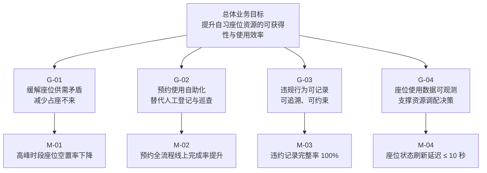

**图 GT-01 目标树**（建模对象：智慧自习室预约与管理系统的业务目标体系；关联需求：G-01—G-04、M-01—M-04）

| 编号 | 业务目标 | 来源性质 |
|---|---|---|
| G-01 | 缓解自习室座位供需矛盾，减少「占而不用」造成的资源浪费 | 分析推导 |
| G-02 | 将座位分配与使用记录从人工登记与现场巡查转为线上自助预约与自动记录 | 原始资料 |
| G-03 | 使违规占用行为可记录、可追溯、可约束，降低管理纠纷成本 | 原始资料 |
| G-04 | 使座位使用情况可量化观测，为开放区域与开放时间的调整提供依据 | 原始资料 |

### 2.2 成功指标

| 编号 | 成功指标 | 度量方式 | 来源性质 |
|---|---|---|---|
| M-01 | 高峰时段（考试周、19:00—22:00）座位空置率下降 | 对比统计页面的座位使用率曲线 | AI 候选 |
| M-02 | 预约、签到、签退、取消四个环节全部可在线上完成，无需人工登记 | 全流程走查 | 分析推导 |
| M-03 | 每一次未签到、未签退与现场违规占用均产生一条可查询的违约记录 | 违约记录完整率 100% | 原始资料 |
| M-04 | 数据分析页面的座位状态与统计数值刷新延迟不超过 10 秒 | 页面自动刷新间隔观测 | 原始资料 |
| M-05 | 座位当前状态与现场实际情况一致，管理员可据此处理现场问题 | 抽样比对实时座位视图与现场 | 分析推导 |
| M-06 | 投诉从提交到反馈形成闭环，处理过程可查 | 投诉单状态闭环率 | 分析推导 |

### 2.3 系统范围

**范围内**：

1. 自习室、区域、座位三级资源的基础信息与状态维护。
2. 学生侧的座位查询、预约、取消预约、签到、签退。
3. 系统侧的超时未签到、超时未签退自动判定与违约记录生成。
4. 管理员侧的实时座位管理、手动违约登记、座位使用与预约记录查看。
5. 学生侧的预约查询、座位查询、个人违约记录查询。
6. 评价管理、投诉与反馈、黑名单管理；用户信息维护列为后续扩展，本期仅保留本人账号展示（Q-38）。
7. 座位使用数据的柱状图、折线图与统计数值展示，每 10 秒自动刷新。
8. 支撑上述功能所需的登录认证、通知提醒、规则参数配置与审计日志。

**范围外**（明确不在本期实现）：

| 编号 | 排除项 | 说明 |
|---|---|---|
| O-01 | 门禁闸机与硬件联动控制 | 不控制物理门锁、闸机与灯光，签到仅做业务记录 |
| O-02 | 在线支付与罚金收取 | 违约仅做记录与使用权限限制，不涉及资金 |
| O-03 | 座位现场设备的占用传感器接入 | 座位状态由预约与签到数据驱动，不依赖硬件探测 |
| O-04 | 校外人员或访客的预约 | 仅面向本校师生，依赖统一身份认证 |
| O-05 | 教室排课与课表联动 | 不读取教务课表，不处理教学占用 |

### 2.4 系统上下文

<!-- FIG:CM-01-系统上下文图 -->
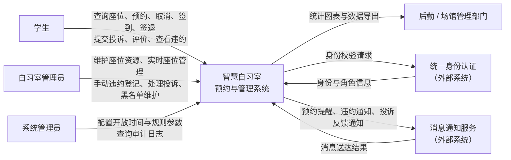

**图 CM-01 系统上下文图**（建模对象：系统边界与外部交互；关联需求：FR-01、FR-09、FR-12、FR-11）

| 编号 | 外部角色 / 系统 | 交互方向 | 主要交互内容 | 来源性质 |
|---|---|---|---|---|
| SH-01 | 学生 | 双向 | 查询、预约、取消、签到、签退、投诉、评价、查询违约记录 | 原始资料 |
| SH-02 | 自习室管理员 | 双向 | 资源维护、实时座位管理、手动违约登记、投诉处理、黑名单维护 | 原始资料 |
| SH-03 | 系统管理员 | 双向 | 规则参数配置、审计日志查询 | AI 候选 |
| SH-04 | 后勤 / 场馆管理部门 | 单向（接收） | 统计图表与统计数据导出 | 原始资料 |
| SH-05 | 统一身份认证系统 | 双向 | 校验身份与获取角色信息 | 分析推导 |
| SH-06 | 消息通知服务 | 双向 | 发送预约提醒、违约通知与投诉反馈通知 | AI 候选 |

---

## 3 涉众与用户角色

### 3.1 涉众

| 编号 | 涉众 | 关注点 | 对系统的影响 |
|---|---|---|---|
| SH-01 | 学生（使用者） | 能否快速找到并稳定获得可用座位；违约判定是否公正；申诉渠道是否畅通 | 系统的主要使用者，其体验决定系统是否被采用 |
| SH-02 | 自习室管理员 | 座位现状是否与现场一致；违规处理是否有据；工作量是否下降 | 系统的业务执行者，决定规则能否落地 |
| SH-03 | 系统管理员 | 参数是否可配置；异常是否可追溯；数据是否完整 | 系统的运行维护者 |
| SH-04 | 后勤 / 场馆管理部门 | 座位使用率与趋势能否支撑开放计划 | 数据的最终使用方 |
| SH-07 | 校方管理部门 | 违规记录与投诉处理是否合规、是否留存证据 | 制度约束的提出方 |
| SH-08 | 开发与运维团队 | 需求是否可实现、可测试 | 依据本文档开展设计与开发 |

### 3.2 用户角色

| 编号 | 角色 | 对应涉众 | 角色目标 | 权限概览 |
|---|---|---|---|---|
| R-01 | 学生 | SH-01 | 完成查询、预约、签到签退、评价与投诉，了解自身信用状态 | 仅能操作与本人相关的数据 |
| R-02 | 自习室管理员 | SH-02 | 维护座位资源与实时状态、处理违约与投诉、维护黑名单 | 在授权自习室范围内执行管理与处置 |
| R-03 | 系统管理员 | SH-03 | 配置规则参数、查看审计日志 | 全系统配置与日志查询，不直接代学生预约 |
| R-04 | 后勤 / 场馆管理部门 | SH-04 | 查看与导出统计数据 | 只读访问统计结果 |

> 说明：学生角色为本人数据的唯一操作者，任何跨用户的查询与修改均被拒绝；管理员角色不得代替学生签到，也不得直接修改学生的预约记录以规避违约判定，如需纠正须通过申诉流程并留痕。

## 4 功能需求

功能需求共 14 项，其中 FR-02 至 FR-11 覆盖 REF-01 列明的七条核心功能与约束，FR-01、FR-12、FR-13、FR-14 为支撑上述功能运转所必需的基础能力。

| 原始资料条目（REF-01） | 对应功能需求 |
|---|---|
| 1. 自习室（座位）资源（属性）管理 | FR-02 |
| 2. 预约管理功能：（用户、管理员） | FR-03 |
| 3. 预约及取消预约、签到及签退、自动违约记录 | FR-04、FR-05 |
| 4. 相关查询：预约查询、座位查询、违规记录查询等 | FR-06 |
| 5. 管理员：实时座位管理（手动违约登记）、座位使用预约记录 | FR-07 |
| 6. 用户管理：用户信息管理（评价管理）、用户投诉管理、投诉反馈信息、黑名单管理 | FR-08、FR-09、FR-10 |
| 7. 数据分析：柱状图分析、折线图分析、统计数据等，每 10 秒自动刷新 | FR-11 |

### 4.1 FR-01 登录与身份认证

| 项目 | 内容 |
|---|---|
| 需求编号 | FR-01 |
| 需求名称 | 登录与身份认证 |
| 需求描述 | 用户通过校内统一身份认证登录系统；系统据此取得用户身份与所属角色（学生、自习室管理员、系统管理员、后勤部门），并在会话有效期内维持登录状态，超时自动退出 |
| 优先级 | 必做 |
| 来源性质 | AI 候选 |
| 关联用户故事 | US-01 |
| 关联用例 | UC-01 |
| 关联业务规则 | BR-21、BR-24 |
| 验收标准 | AC-01-01、AC-01-02、AC-01-03、AC-01-04 |

功能要点：

1. 登录成功后按角色进入对应工作台，页面上只呈现该角色可执行的操作入口。
2. 权限判定在后端完成；前端隐藏按钮不作为权限依据。
3. 同一位学生同时只允许一个有效登录会话、管理员账号允许一人多端，以及关键处置操作的服务端二次确认，列为后续扩展；本期保留关键处置操作的前端确认提示（前端 confirm），并明确其不构成服务端安全边界（Q-37）。
4. 连续登录失败达到阈值时短暂锁定账号。

### 4.2 FR-02 自习室与座位资源管理

| 项目 | 内容 |
|---|---|
| 需求编号 | FR-02 |
| 需求名称 | 自习室与座位资源管理 |
| 需求描述 | 维护「自习室 → 区域 → 座位」三级资源及其属性；支持自习室开放时间与开放状态设置、区域划分、座位新增/修改/停用与座位类型标注 |
| 优先级 | 必做 |
| 来源性质 | 原始资料 |
| 关联用户故事 | US-02、US-14 |
| 关联用例 | UC-02 |
| 关联业务规则 | BR-01、BR-02、BR-23 |
| 验收标准 | AC-02-01、AC-02-02、AC-02-03、AC-02-04 |

功能要点：

1. 自习室属性：编号、名称、楼栋/楼层、位置描述、开放时间、开放状态（开放/关闭）、备注。
2. 区域属性：编号、所属自习室、区域名称、区域类型（静音区/讨论区/电源区等）、排序。
3. 座位属性：编号、所属区域、座位编号、座位类型（普通/带电源/靠窗/隔断）、状态、位置描述、是否可预约。
4. 座位停用期间不接受任何新预约；该座位已存在的未来预约由系统通知本人并自动取消，不记违约。
5. 管理员仅能维护本人被授权的自习室；跨自习室维护请求被拒绝。

### 4.3 FR-03 预约管理

| 项目 | 内容 |
|---|---|
| 需求编号 | FR-03 |
| 需求名称 | 预约管理 |
| 需求描述 | 学生按自习室、区域、日期与时间段查询可用座位并提交预约；管理员在授权范围内代学生创建、调整或取消预约并注明原因，该能力列为后续扩展，本期仅支持学生本人预约（Q-26） |
| 优先级 | 必做 |
| 来源性质 | 原始资料 |
| 关联用户故事 | US-03、US-14 |
| 关联用例 | UC-03、UC-04 |
| 关联业务规则 | BR-03、BR-04、BR-05、BR-06、BR-13、BR-23 |
| 验收标准 | AC-03-01 至 AC-03-05 |

功能要点：

1. 预约提交时依次校验：账号状态是否允许预约、是否超出同时有效预约上限、时段是否在开放时间内、时长是否在允许区间内、提前天数是否超限、目标座位在该时段是否空闲。
2. 任一校验不通过时明确提示不通过的原因，且不产生预约单、不改变座位状态。
3. 同一座位同一时段的并发预约请求中，只有一个能够成功，其余被拒绝（不出现重复占用）。
4. 预约成功后生成预约单并占用目标座位，同时向学生发送预约成功通知。
5. 管理员代创建预约（含填写原因并写入审计日志）列为后续扩展，本期不实现；本期预约仅由学生本人发起（Q-26）。

### 4.4 FR-04 取消预约、签到与签退

| 项目 | 内容 |
|---|---|
| 需求编号 | FR-04 |
| 需求名称 | 取消预约、签到与签退 |
| 需求描述 | 学生在预约开始前可自行取消预约；在签到时间窗内完成签到开始使用座位；使用结束后签退释放座位 |
| 优先级 | 必做 |
| 来源性质 | 原始资料 |
| 关联用户故事 | US-04、US-05、US-06 |
| 关联用例 | UC-05、UC-06、UC-07 |
| 关联业务规则 | BR-07、BR-08、BR-09、BR-10、BR-22 |
| 验收标准 | AC-04-01 至 AC-04-06 |

功能要点：

1. 取消预约仅在预约开始前允许；开始后如需终止使用，走签退流程。
2. 取消预约不记违约；距开始时间不足阈值（见 BR-10，待确认）时是否限制取消次数由 Q-07 决定。
3. 签到方式支持座位二维码扫码签到与输入座位编号签到，二者结果一致。
4. 签到成功后座位由「已预约」变为「使用中」，预约单由「待签到」变为「使用中」。
5. 签退成功后座位回到「空闲」，预约单变为「已完成」，同时记录实际使用时长。
6. 学生在预约开始前修改预约时段（须重新通过 FR-03 全部校验，仅允许一次）列为后续扩展，本期不实现（Q-27、Q-08）。

### 4.5 FR-05 自动违约记录与申诉

| 项目 | 内容 |
|---|---|
| 需求编号 | FR-05 |
| 需求名称 | 自动违约记录与申诉 |
| 需求描述 | 系统自动判定超时未签到与超时未签退行为并生成违约记录，同步释放座位；学生可查询本人违约记录并对生效中的记录发起申诉，由管理员复核 |
| 优先级 | 必做 |
| 来源性质 | 原始资料 |
| 关联用户故事 | US-08、US-09 |
| 关联用例 | UC-08、UC-09 |
| 关联业务规则 | BR-08、BR-09、BR-11、BR-12、BR-14 |
| 验收标准 | AC-05-01 至 AC-05-07 |

功能要点：

1. 违约类型：V1 超时未签到（爽约）、V2 超时未签退、V3 管理员手动登记。
2. 违约记录字段：记录编号、学生、关联预约单、违约类型、发生时间、座位、判定依据、处理结果、申诉状态。
3. 自动判定由系统定时扫描完成，扫描间隔须保证「超过截止时刻」与「生成违约记录」之间的延迟不超过 NFR-03 规定值。
4. 违约记录生成后立即释放座位并通知学生；累计计数达到阈值时触发 FR-10 的黑名单流程。
5. 申诉仅对生效中的违约记录开放，申诉期见 BR-14（待确认）；申诉期间记录保持生效，不因申诉而暂停计数。
6. 申诉成立时撤销违约记录并回退累计违约计数，回退结果写入审计日志；申诉不成立时保留记录并给出理由。

### 4.6 FR-06 查询

| 项目 | 内容 |
|---|---|
| 需求编号 | FR-06 |
| 需求名称 | 预约查询、座位查询与违规记录查询 |
| 需求描述 | 提供面向学生的座位可用性查询与个人记录查询，以及面向管理员的预约与违规记录查询 |
| 优先级 | 必做 |
| 来源性质 | 原始资料 |
| 关联用户故事 | US-02、US-08、US-17 |
| 关联用例 | UC-03、UC-09 |
| 关联业务规则 | BR-01、BR-03 |
| 验收标准 | AC-06-01 至 AC-06-04 |

功能要点：

1. 座位查询支持按楼栋、自习室、区域、日期、时间段、座位类型组合筛选，返回结果标注每个座位的当前状态与可预约时段。
2. 预约查询支持按日期区间、状态、自习室筛选；学生只能查询本人预约，管理员可查询授权范围内全部预约。
3. 违规记录查询支持按学生、违约类型、时间区间、处理状态筛选；学生仅能查询本人记录。
4. 所有查询结果可分页；导出为扩展能力（见第 14 章优先级划分）。

### 4.7 FR-07 管理员实时座位管理与手动违约登记

| 项目 | 内容 |
|---|---|
| 需求编号 | FR-07 |
| 需求名称 | 实时座位管理、手动违约登记与使用预约记录 |
| 需求描述 | 管理员以座位平面视图实时查看授权自习室的座位状态，对现场情况进行处置，包括手动登记违约、提前释放座位、临时停用座位，并查看座位的使用与预约记录 |
| 优先级 | 必做 |
| 来源性质 | 原始资料 |
| 关联用户故事 | US-15、US-16、US-17 |
| 关联用例 | UC-10 |
| 关联业务规则 | BR-11、BR-22、BR-24 |
| 验收标准 | AC-07-01 至 AC-07-06 |

功能要点：

1. 实时座位视图按自习室与区域展示座位矩阵，用颜色区分空闲、已预约、使用中、停用，并标注当前使用者（脱敏显示）与预约时段。
2. 视图数据随 FR-11 的刷新周期同步更新，管理员可手动触发刷新。
3. 手动违约登记必须选择违约类型并填写原因，提交后生成 V3 违约记录，座位立即释放，学生收到通知。
4. 手动违约登记不覆盖已有的自动违约记录；同一预约单同一事实不重复生成违约记录。
5. 管理员可查看任一座位的历史使用与预约记录，用于核对争议与处理申诉。

### 4.8 FR-08 用户信息管理与评价管理

| 项目 | 内容 |
|---|---|
| 需求编号 | FR-08 |
| 需求名称 | 用户信息管理与评价管理 |
| 需求描述 | 维护用户基础信息与账号状态；学生对使用过的自习室或座位提交评分与评论，管理员对违规内容进行隐藏 |
| 优先级 | 必做 |
| 来源性质 | 原始资料 |
| 关联用户故事 | US-12 |
| 关联用例 | UC-12 |
| 关联业务规则 | BR-18、BR-19 |
| 验收标准 | AC-08-01 至 AC-08-04 |

功能要点：

1. 用户信息包含学号、姓名、所属院系、联系方式、账号状态、累计违约次数、当前黑名单状态。本期仅展示本人上述信息；用户信息维护与管理员用户查询列为后续扩展（Q-38）。
2. 学生只能查看与修改本人联系方式等非关键字段；学号、姓名以统一身份认证为准，不可在本系统修改。该修改能力列为后续扩展，本期仅保留本人账号展示（Q-38）。
3. 评价须与被评价对象存在真实使用关系（该学生在该座位存在已完成的预约），否则拒绝提交。
4. 评价内容一经提交不可修改；管理员可因违规内容隐藏评价，隐藏须填写理由并留痕，隐藏后的评价不计入平均分。
5. 评价结果在座位与自习室详情中聚合展示（平均分与评价条数）。

### 4.9 FR-09 投诉管理与反馈

| 项目 | 内容 |
|---|---|
| 需求编号 | FR-09 |
| 需求名称 | 用户投诉管理与投诉反馈 |
| 需求描述 | 学生提交投诉并跟踪处理进展；管理员受理、调查、回复并关闭投诉单，投诉人与被投诉人可查看反馈信息 |
| 优先级 | 必做 |
| 来源性质 | 原始资料 |
| 关联用户故事 | US-10、US-11、US-18 |
| 关联用例 | UC-11 |
| 关联业务规则 | BR-15、BR-16、BR-17 |
| 验收标准 | AC-09-01 至 AC-09-06 |

功能要点：

1. 投诉对象三类：座位/自习室（设施与环境）、其他用户（占座、噪音等）、管理员（处置争议）。
2. 投诉单字段：投诉单编号、投诉人、投诉对象类型、被投诉对象、投诉类型、内容描述、证据附件、提交时间、当前状态、处理人、处理记录、反馈内容、关闭时间。
3. 投诉必须实名提交，且投诉人须为登录状态；被投诉人的个人信息在投诉单中对投诉人脱敏。
4. 管理员受理后进入处理中；提交反馈后进入已回复；达到自动关闭时限后进入已关闭。投诉人确认反馈后关闭（ST-27）列为后续扩展，本期不实现（Q-31）。
5. 投诉人可对反馈申请复核一次；复核后投诉单回到处理中，由管理员再次反馈或等待自动关闭，结果留档（Q-31）。
6. 投诉处理全过程写入审计日志；对被投诉学生的处理结果（如手动违约）单独生成对应业务记录，不直接改写已有记录。
7. 受理超期提醒（ST-30、EX-09）与投诉不成立关闭（ST-25）列为后续扩展，本期不实现；本期只保留受理、反馈、复核与自动关闭（Q-17、Q-30、Q-31）。

### 4.10 FR-10 黑名单管理

| 项目 | 内容 |
|---|---|
| 需求编号 | FR-10 |
| 需求名称 | 黑名单管理 |
| 需求描述 | 依据累计违约次数自动判定并加入黑名单，管理员可对黑名单进行查询与提前解除（延期列为后续扩展，Q-28）；学生可查看本人黑名单状态与解除条件 |
| 优先级 | 必做 |
| 来源性质 | 原始资料 |
| 关联用户故事 | US-13、US-19 |
| 关联用例 | UC-13 |
| 关联业务规则 | BR-12、BR-13 |
| 验收标准 | AC-10-01 至 AC-10-05 |

功能要点：

1. 自动触发：有效违约累计次数达到阈值时，账号自动进入黑名单并记录生效时间与失效时间。
2. 黑名单期间禁止发起新预约；已存在的有效预约是否保留见 Q-05（待确认）。
3. 管理员解除须填写理由；解除后累计违约次数是否清零见 Q-06（待确认）。
4. 黑名单状态的每一次变化均写入审计日志，并可通知本人。
5. 学生可查看本人当前是否处于黑名单、剩余时长与解除条件。
6. 管理员直接加入黑名单（ST-20）与延期（ST-21）列为后续扩展，本期仅保留自动加入、期限届满解除与提前解除（Q-28）。

### 4.11 FR-11 数据分析与可视化

| 项目 | 内容 |
|---|---|
| 需求编号 | FR-11 |
| 需求名称 | 数据分析与可视化 |
| 需求描述 | 以柱状图、折线图与统计数值展示座位使用与预约情况，页面每 10 秒自动刷新 |
| 优先级 | 必做 |
| 来源性质 | 原始资料 |
| 关联用户故事 | US-20、US-23 |
| 关联用例 | UC-14 |
| 关联业务规则 | BR-20 |
| 验收标准 | AC-11-01 至 AC-11-06 |

功能要点：

1. 柱状图：各自习室/各时段座位使用率对比、违约次数按自习室或院系分布。
2. 折线图：近 7 日与近 30 日预约量趋势、座位使用率随时间变化趋势。
3. 统计数值：当前在座人数、当前空闲座位数、今日预约总数、今日违约数、待受理投诉数、黑名单人数。
4. 所有图表与数值在同一页面内展示，每 10 秒自动刷新一次，刷新不打断用户当前操作（不整页重载、不重置筛选条件）。
5. 支持筛选维度：日期范围、自习室、时段；筛选条件在自动刷新后保持不变。
6. 后勤部门角色对统计页面只读，可导出统计结果（导出为扩展能力）。
7. 使用率、时段、院系维度列为后续扩展；本期统计按自习室 + 日粒度（Q-39）。

### 4.12 FR-12 通知与提醒

| 项目 | 内容 |
|---|---|
| 需求编号 | FR-12 |
| 需求名称 | 通知与提醒 |
| 需求描述 | 在预约与违约关键节点向相关用户发送通知，提醒即将开始与即将超时的事项 |
| 优先级 | 扩展 |
| 来源性质 | AI 候选 |
| 关联用户故事 | US-07 |
| 关联用例 | UC-15 |
| 关联业务规则 | BR-08、BR-09、BR-12、BR-16 |
| 验收标准 | AC-12-01 至 AC-12-03 |

功能要点：

1. 通知类型：预约成功、预约开始前提醒、签到即将截止提醒、违约记录生成、申诉结果、投诉受理与反馈、黑名单生效与解除。接近黑名单阈值提醒列为后续扩展，本期不实现（Q-45）。
2. 通知通道为系统内消息；接入外部消息服务（短信/公众号）为扩展能力，其通道选择见 Q-11。
3. 通知送达情况记入系统，便于核对用户是否知晓。

### 4.13 FR-13 开放时间与规则参数配置

| 项目 | 内容 |
|---|---|
| 需求编号 | FR-13 |
| 需求名称 | 开放时间与业务规则参数配置 |
| 需求描述 | 系统管理员在后台维护自习室开放时间以及业务规则中涉及的全部数值参数，调整后即时生效，无需修改程序 |
| 优先级 | 必做 |
| 来源性质 | AI 候选 |
| 关联用户故事 | US-21 |
| 关联用例 | UC-16 |
| 关联业务规则 | BR-04、BR-05、BR-06、BR-07、BR-10、BR-12、BR-16、BR-17 |
| 验收标准 | AC-13-01 至 AC-13-04 |

功能要点：

1. 可配置参数至少包括：单次预约时长上下限、可提前预约天数、同时有效预约上限、签到时间窗、违约累计阈值、黑名单期限、投诉受理与反馈时限、申诉期、数据刷新间隔。
2. 每项参数须给出默认值、取值范围与说明；取值超出范围时拒绝保存并提示。其中违约判定扫描间隔 P-15 的取值范围为 10—60 秒，与 NFR-03 的「不超过 1 分钟」一致（Q-18）。
3. 参数变更记录变更人、变更时间与前后取值，写入审计日志。
4. 参数变更只影响变更之后产生的业务判定，不追溯修改已有记录。
5. 参数页须标注每项参数的生效点；当前未接入业务判定的参数标注为「未接入」，AC-13-01 仅对已接线参数宣称即时生效（Q-32）。

### 4.14 FR-14 审计日志

| 项目 | 内容 |
|---|---|
| 需求编号 | FR-14 |
| 需求名称 | 审计日志 |
| 需求描述 | 记录关键操作的操作人、角色、操作类型、目标对象、时间与结果，供系统管理员查询与追溯 |
| 优先级 | 必做 |
| 来源性质 | AI 候选 |
| 关联用户故事 | US-22 |
| 关联用例 | UC-17 |
| 关联业务规则 | BR-22、BR-24 |
| 验收标准 | AC-14-01 至 AC-14-04 |

功能要点：

1. 必须记录的操作：座位资源的增删改与停用、规则参数变更、手动违约登记、申诉复核结论、黑名单生效/解除（延期列为后续，Q-28）、投诉受理与反馈、管理员代创建预约（列为后续，Q-26）、账号状态变更。
2. 日志须包含操作前后状态或关键字段的前后取值。
3. 日志只可查询、不可修改与删除；保留期限见 NFR-14。
4. 查询支持按操作人、操作类型、目标对象、时间区间组合筛选。

---

## 5 用户故事与用例

### 5.1 用户故事

优先级取值：必做／扩展／暂不实现。每则用户故事关联功能需求；对应的验收标准见第 13 章，编号为 AC-功能需求序号-序号。

| 编号 | 角色 | 用户故事 | 优先级 | 关联需求 |
|---|---|---|---|---|
| US-01 | R-01 学生 | 作为学生，我希望使用学号经统一身份认证登录，以便只让本校师生使用预约服务 | 必做 | FR-01 |
| US-02 | R-01 学生 | 作为学生，我希望按楼栋、区域与时间段查看空闲座位，以便快速选到合适的座位 | 必做 | FR-02、FR-06 |
| US-03 | R-01 学生 | 作为学生，我希望选定座位与时段后一次提交即完成预约，以便可靠地锁定座位 | 必做 | FR-03 |
| US-04 | R-01 学生 | 作为学生，我希望在预约开始前自行取消预约，以便计划改变时不产生违约 | 必做 | FR-04 |
| US-05 | R-01 学生 | 作为学生，我希望到场后扫码或输入座位编号完成签到，以便开始使用座位 | 必做 | FR-04 |
| US-06 | R-01 学生 | 作为学生，我希望离开时签退，以便释放座位并结束本次使用记录 | 必做 | FR-04 |
| US-07 | R-01 学生 | 作为学生，我希望在预约即将开始和签到即将截止时收到提醒，以免因忘记签到而被记违约 | 扩展 | FR-12 |
| US-08 | R-01 学生 | 作为学生，我希望查询本人的历史预约与违约记录，以便了解自身信用状况 | 必做 | FR-05、FR-06 |
| US-09 | R-01 学生 | 作为学生，我希望对生效中的违约记录发起申诉，以便纠正误判 | 必做 | FR-05 |
| US-10 | R-01 学生 | 作为学生，我希望提交对座位环境、其他使用者或管理员的投诉，以便维护使用秩序 | 必做 | FR-09 |
| US-11 | R-01 学生 | 作为学生，我希望查看投诉的处理进展与反馈内容，以便确认问题确实被处理 | 必做 | FR-09 |
| US-12 | R-01 学生 | 作为学生，我希望对使用过的自习室与座位提交评分与评论，以便为他人提供参考 | 必做 | FR-08 |
| US-13 | R-01 学生 | 作为学生，我希望看到本人黑名单状态、剩余时长与解除条件，以便知道何时恢复预约权限 | 必做 | FR-10 |
| US-14 | R-02 管理员 | 作为自习室管理员，我希望维护自习室、区域与座位的基础信息与状态，以便资源信息与实际一致 | 必做 | FR-02、FR-03 |
| US-15 | R-02 管理员 | 作为自习室管理员，我希望以平面视图实时查看座位状态与当前使用者，以便及时处理现场情况 | 必做 | FR-07 |
| US-16 | R-02 管理员 | 作为自习室管理员，我希望对现场违规占用当场手动登记违约，以便对违规行为形成约束 | 必做 | FR-05、FR-07 |
| US-17 | R-02 管理员 | 作为自习室管理员，我希望查看座位的使用与预约记录，以便核对争议、处理申诉与投诉 | 必做 | FR-06、FR-07 |
| US-18 | R-02 管理员 | 作为自习室管理员，我希望受理、调查并回复学生投诉，以便问题处置形成闭环 | 必做 | FR-09 |
| US-19 | R-02 管理员 | 作为自习室管理员，我希望查询、解除与延期黑名单，以便执行处罚并处理特殊情况 | 必做 | FR-10 |
| US-20 | R-02 管理员 | 作为自习室管理员，我希望查看座位使用率与预约趋势图表，以便安排开放区域与巡检人员 | 必做 | FR-11 |
| US-21 | R-03 系统管理员 | 作为系统管理员，我希望在后台配置开放时间与规则参数，以便调整业务口径时无需修改程序 | 必做 | FR-13 |
| US-22 | R-03 系统管理员 | 作为系统管理员，我希望查询关键操作的审计日志，以便追溯异常操作与处理纠纷 | 必做 | FR-14 |
| US-23 | R-04 后勤部门 | 作为后勤与场馆管理部门人员，我希望查看并导出座位使用统计数据，以便为开放计划与场馆改造提供依据 | 扩展 | FR-11 |

### 5.2 用例图

<!-- FIG:UCD-01-用例图 -->
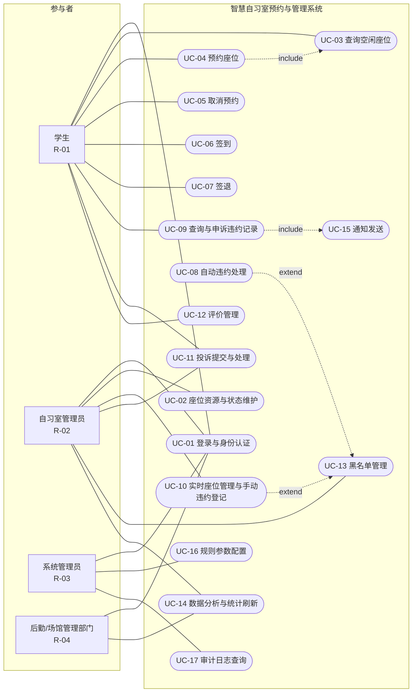

**图 UCD-01 用例图**（建模对象：系统功能与参与者的关系；关联需求：FR-01—FR-14）

> 表达方式说明：本图以 Mermaid `flowchart` 近似表达 UML 用例图语义——矩形节点表示参与者，椭圆节点表示用例，实线表示参与者与用例之间的关联，虚线箭头分别表示 `include`（包含）与 `extend`（扩展）关系。因 Mermaid 无原生用例图语法，此处以等价图元表达，语义与 UML 用例图一致。
>
> 图中画出的关系与下表逐条对应，不存在图中未画而本注未说明的关系。
>
> | 关系类型 | 图中线条 | 说明 |
> |---|---|---|
> | 参与者关联 | 学生—UC-01/03/04/05/06/07/09/11/12；自习室管理员—UC-01/02/10/11/13/14；系统管理员—UC-01/16/17；后勤部门—UC-01/14 | 参与者可执行的用例 |
> | include | UC-04 → UC-03、UC-09 → UC-15 | 预约须先查询座位；申诉结果须通知本人 |
> | extend | UC-08 → UC-13、UC-10 → UC-13 | 违约累计达阈值或管理员直接处置时扩展至黑名单管理 |
>
> 未画出的包含关系（图中无对应线条）：UC-05、UC-06、UC-08、UC-11、UC-13 与 UC-04 同样在关键节点包含 UC-15（通知发送），即取消预约、签到、违约生成、投诉受理与反馈、黑名单生效与解除时向相关用户发送通知。这些关系以 5.3 用例清单与第 12 章异常场景为准，图中不再重复绘制。

### 5.3 用例清单

| 编号 | 用例名称 | 主要参与者 | 前置条件 | 后置条件 | 关联需求 |
|---|---|---|---|---|---|
| UC-01 | 登录与身份认证 | 全部角色 | 用户已获得校内统一身份认证账号 | 建立会话并加载对应角色工作台 | FR-01 |
| UC-02 | 座位资源与状态维护 | R-02、R-03 | 管理员已登录且被授权该自习室 | 资源信息或座位状态被更新并留痕 | FR-02 |
| UC-03 | 查询空闲座位 | R-01 | 已登录 | 返回符合条件的座位及可用时段 | FR-06 |
| UC-04 | 预约座位 | R-01、R-02（代创建） | 已登录、账号状态允许预约、目标座位在所选时段空闲；代创建时管理员须填写原因 | 生成预约单，座位变为已预约；代创建时记录创建来源并写入审计日志 | FR-03 |
| UC-05 | 取消预约 | R-01 | 存在本人「待生效」预约且未到开始时间 | 预约单变为已取消，座位回到空闲，不记违约 | FR-04 |
| UC-06 | 签到 | R-01 | 预约单处于「待签到」且在签到时间窗内 | 预约单变为使用中，座位变为使用中 | FR-04 |
| UC-07 | 签退 | R-01 | 预约单处于「使用中」 | 预约单变为已完成，座位回到空闲，记录实际时长 | FR-04 |
| UC-08 | 自动违约处理 | 系统定时任务 | 存在已超过签到截止或结束时刻仍未终结的预约单 | 生成违约记录、释放座位、通知学生，必要时触发黑名单 | FR-05 |
| UC-09 | 查询与申诉违约记录 | R-01、R-02 | 已登录；发起申诉时须存在本人「生效中」且在申诉期内的违约记录 | 返回记录；申诉后违约记录进入「申诉中」；判定成立时记录转为「申诉成立已撤销」并回退有效违约计数 | FR-05、FR-06 |
| UC-10 | 实时座位管理与手动违约登记 | R-02 | 管理员已登录且被授权该自习室 | 座位状态或违约记录被更新并留痕 | FR-07 |
| UC-11 | 投诉提交与处理 | R-01、R-02 | 投诉人已登录；管理员已登录且被授权 | 投诉单状态推进；反馈内容对学生可见 | FR-09 |
| UC-12 | 评价管理 | R-01、R-02 | 学生在被评价对象上存在已完成的预约 | 评价被保存并参与聚合展示；违规内容可被隐藏 | FR-08 |
| UC-13 | 黑名单管理 | R-02、系统 | 违约累计达阈值或管理员发起处置 | 账号状态变更并留痕、通知本人 | FR-10 |
| UC-14 | 数据分析与统计刷新 | R-02、R-04 | 已登录 | 图表与统计数值按 10 秒周期自动更新 | FR-11 |
| UC-15 | 通知发送 | 系统（由其他用例触发） | 触发事件发生且通知模板已配置 | 通知写入用户消息并记录送达结果 | FR-12 |
| UC-16 | 规则参数配置 | R-03 | 系统管理员已登录 | 参数更新并写入审计日志 | FR-13 |
| UC-17 | 审计日志查询 | R-03 | 系统管理员已登录 | 返回符合条件的日志记录 | FR-14 |

### 5.4 核心用例描述

以下用例给出主流程、备选流与异常处理：UC-01、UC-02、UC-04、UC-06、UC-08、UC-09、UC-10、UC-11、UC-12、UC-14、UC-16、UC-17。

其余用例（UC-03 查询空闲座位、UC-05 取消预约、UC-07 签退、UC-13 黑名单管理、UC-15 通知发送）不单独展开，其行为以 5.3 用例清单的前置与后置条件、第 7 章对应状态模型、第 8 章活动图（覆盖关系见各活动图图注）以及第 4 章相应功能需求的功能要点为准。

#### UC-01 登录与身份认证

- 主要参与者：全部角色（R-01 学生、R-02 自习室管理员、R-03 系统管理员、R-04 后勤部门）
- 关联需求：FR-01；关联规则：BR-21、BR-25；关联状态转换：ST-32、ST-33、ST-34
- 前置条件：用户已持有校内统一身份认证账号
- 后置条件（成功）：建立会话并按角色加载工作台，该账号的连续登录失败计数清零
- 后置条件（失败）：不建立会话；账号状态按 BR-25 保持「正常」或进入「锁定」，失败计数累加

主流程：

| 步骤 | 参与者 | 系统响应 |
|---|---|---|
| 1 | 用户提交学号与凭证 | 转发至统一身份认证校验 |
| 2 | — | 校验通过，建立会话，按角色加载对应工作台 |
| 3 | — | 登录成功，该账号的连续登录失败计数清零 |
| 4 | 用户使用系统 | 会话在连续 30 分钟无操作后失效（NFR-08、P-17） |

备选流：

| 编号 | 触发条件 | 处理 |
|---|---|---|
| A1 | 凭证校验失败 | 拒绝登录并提示凭证错误；连续失败计数加 1，未达阈值时账号状态保持「正常」（BR-25） |
| A2 | 连续登录失败达到阈值（候选值 5 次） | 账号进入「锁定」并记录自动解锁时间（候选值 15 分钟），拒绝继续登录并通知本人（BR-25、ST-32、AC-01-04） |
| A3 | 账号处于锁定期间再次尝试登录 | 拒绝登录并提示锁定剩余时间，账号保持「锁定」，不建立会话；已有的预约与签到签退不受影响（ST-34） |
| A4 | 锁定期限届满 | 账号自动恢复为「正常」，失败计数清零，可正常登录（ST-33） |
| A5 | 统一身份认证服务不可用 | 提示认证服务暂不可用并保留重试入口；已登录用户的会话在有效期内继续可用（EX-13） |

#### UC-02 座位资源与状态维护

- 主要参与者：R-02 自习室管理员、R-03 系统管理员
- 关联需求：FR-02；关联规则：BR-01、BR-02、BR-21、BR-22、BR-23；关联状态转换：ST-08、ST-09、ST-10
- 前置条件：管理员已登录且被授权该自习室
- 后置条件（成功）：资源信息或座位状态被更新，操作与前后状态写入审计日志
- 后置条件（失败/拒绝）：资源与座位状态保持不变，管理员收到明确的拒绝原因

主流程：

| 步骤 | 参与者 | 系统响应 |
|---|---|---|
| 1 | 管理员打开资源管理页 | 返回其被授权自习室的「自习室—区域—座位」三级结构 |
| 2 | 管理员新增或修改自习室、区域、座位的属性 | 校验必填项与编号唯一性后保存 |
| 3 | 管理员将某座位置为「停用」并填写原因 | 座位变为「停用」；该座位已存在的未来有效预约经通知本人后自动取消，取消不记违约 |
| 4 | — | 记录操作人、时间、目标对象与前后状态，写入审计日志 |

备选流：

| 编号 | 触发条件 | 处理 |
|---|---|---|
| A1 | 管理员尝试维护未被授权的自习室 | 拒绝请求并提示越权，目标自习室数据保持不变（BR-21） |
| A2 | 新增的座位编号与既有编号重复 | 拒绝保存并提示编号重复，不创建座位 |
| A3 | 停用座位时未填写原因 | 拒绝操作并提示原因必填，座位状态保持原状态（BR-22） |
| A4 | 管理员恢复已停用座位 | 座位由「停用」回到「空闲」并重新可被预约，操作写入审计日志（ST-09） |
| A5 | 任何角色尝试手工直接改写座位状态 | 请求被拒绝，座位状态保持不变（BR-02、权限矩阵第 31 行、AC-02-02） |

#### UC-04 预约座位

- 主要参与者：R-01 学生；R-02 自习室管理员（代创建场景）
- 关联需求：FR-03；关联规则：BR-03、BR-04、BR-05、BR-06、BR-13、BR-23；关联状态转换：ST-01、ST-02
- 前置条件：学生已登录；账号状态允许预约；所选座位与时段在查询结果中显示为可用
- 后置条件（成功）：生成预约单（状态「待生效」），座位由「空闲」变为「已预约」，学生收到预约成功通知
- 后置条件（失败）：不生成预约单，座位状态保持「空闲」，学生收到明确的失败原因

主流程：

| 步骤 | 参与者 | 系统响应 |
|---|---|---|
| 1 | 学生选择自习室、区域、日期与时间段，提交查询 | 返回该时段内状态为「空闲」的座位列表 |
| 2 | 学生选定一个座位并确认预约 | 接收请求，按 BR-03—BR-06、BR-13、BR-23 逐项校验 |
| 3 | — | 校验通过，创建预约单并占用座位，座位状态变为「已预约」 |
| 4 | — | 触发 UC-15 发送预约成功通知，向学生展示预约详情与签到时间窗 |
| 5 | 学生查看预约详情 | 展示预约单编号、座位、时段、签到窗口与取消入口 |

备选流：

| 编号 | 触发条件 | 处理 |
|---|---|---|
| A1 | 学生处于黑名单期间 | 拒绝预约，提示黑名单状态与剩余解除时间，不创建预约单（关联 BR-13、ST-02） |
| A2 | 学生已有有效预约且达到同时预约上限 | 拒绝预约，提示当前有效预约与上限值（关联 BR-04、ST-02） |
| A3 | 所选时长超出允许区间或提前天数超限 | 拒绝预约并提示允许范围（关联 BR-05、BR-06） |
| A4 | 并发提交导致座位已被他人占用 | 后到达的请求被拒绝，提示座位状态已变化并刷新可选列表（关联 EX-02） |
| A5 | 所选时段跨越自习室开放时间边界 | 拒绝预约并提示可预约时段（关联 BR-03） |
| A6 | 管理员为现场学生代创建预约（如学生无法自行操作；本期不实现，列为后续，Q-26） | 以管理员身份按主流程同样校验后创建预约单，并填写代创建原因；预约单的创建来源记为「管理员代创建」，操作写入审计日志（关联 FR-03 功能要点 5、BR-22、ST-01） |

#### UC-06 签到

- 主要参与者：R-01 学生
- 关联需求：FR-04；关联规则：BR-07、BR-08；关联状态转换：ST-03、ST-14、ST-16
- 前置条件：存在本人预约单，状态为「待签到」，当前时刻处于签到时间窗内
- 后置条件（成功）：预约单变为「使用中」，座位由「已预约」变为「使用中」，记录签到时间与方式
- 后置条件（失败）：预约单保持「待签到」，座位保持「已预约」，未产生签到记录

主流程：

| 步骤 | 参与者 | 系统响应 |
|---|---|---|
| 1 | 学生到达座位，扫描座位二维码或输入座位编号 | 校验预约单归属、座位匹配与当前时刻是否在签到时间窗内 |
| 2 | — | 校验通过，写入签到记录，预约单变为「使用中」 |
| 3 | — | 座位由「已预约」变为「使用中」 |
| 4 | — | 展示签到成功与实际开始时间，提示结束时间与签退入口 |

备选流：

| 编号 | 触发条件 | 处理 |
|---|---|---|
| A1 | 当前时刻早于签到窗口开始时间 | 拒绝签到，提示窗口开始时间，预约单与座位状态保持 |
| A2 | 当前时刻已超过签到截止时刻 | 拒绝签到，提示已超出签到时间窗并说明将记违约（关联 BR-08、ST-16） |
| A3 | 所扫/所输座位与预约单座位不一致 | 拒绝签到，提示目标座位不一致，状态保持 |
| A4 | 预约单已被系统判定违约释放 | 拒绝签到，提示预约已终结，状态保持 |

#### UC-08 自动违约处理

- 主要参与者：系统定时任务
- 关联需求：FR-05、FR-10、FR-12；关联规则：BR-08、BR-09、BR-12；关联状态转换：ST-05、ST-07、ST-15、ST-18、ST-19
- 前置条件：存在处于「待签到」且已超过签到截止时刻的预约单，或处于「使用中」且已超过结束时刻的预约单；两类条件分别扫描，但同一预约单只生成首条违约后终结，不生成 V1+V2 双记录（Q-35）
- 后置条件：生成对应类型的违约记录，释放座位，通知学生；累计达阈值时账号进入黑名单并再次通知

主流程：

| 步骤 | 参与者 | 系统响应 |
|---|---|---|
| 1 | — | 定时扫描全部未终结预约单 |
| 2 | — | 分别判定两类违约：命中「超过签到截止仍未签到」的记 V1 未签到（BR-08），命中「超过结束时刻仍未签退」的记 V2 未签退（BR-09） |
| 3 | — | 同一预约单只生成一条违约记录后终结：先命中 V1 则预约单转为「已违约」，不再生成 V2；不允许 V1+V2 双记录（Q-35） |
| 4 | — | 为每一条命中记录生成违约记录，关联预约单与座位；违约记录初始状态为「生效中」 |
| 5 | — | 将预约单置为「已违约」，座位释放为「空闲」 |
| 6 | — | 累加学生有效违约次数，触发 UC-15 发送违约通知 |
| 7 | — | 累计次数达到阈值时，账号进入黑名单（UC-13），并再次通知 |

备选流：

| 编号 | 触发条件 | 处理 |
|---|---|---|
| A1 | 扫描时预约单恰好已被学生签退或取消 | 跳过该记录，不生成违约记录 |
| A2 | 同一预约单在同一事实下已存在违约记录 | 跳过，保证同一事实不重复记录（关联 BR-11） |
| A3 | 违约记录生成时学生正处于申诉通过的撤销流程中 | 先完成撤销计数回退，再按最新计数判定黑名单 |
| A4 | 座位在判定前已被管理员手动释放 | 仍生成自动违约记录，座位状态不重复变更 |

#### UC-09 查询与申诉违约记录

- 主要参与者：R-01 学生（查询与申诉）、R-02 自习室管理员（查询与复核）
- 关联需求：FR-05、FR-06；关联规则：BR-11、BR-14、BR-22；关联状态转换：ST-35、ST-36、ST-37、ST-38
- 前置条件：已登录；发起申诉时须存在本人「生效中」且在申诉期内的违约记录
- 后置条件（成功）：返回符合条件的违约记录；申诉提交后记录进入「申诉中」，判定成立时记录转为「申诉成立已撤销」并回退有效违约计数
- 后置条件（失败/拒绝）：记录状态保持不变，学生收到不可申诉的原因说明

主流程：

| 步骤 | 参与者 | 系统响应 |
|---|---|---|
| 1 | 学生按时间区间、违约类型、处理状态筛选本人违约记录 | 返回符合条件的记录及各自状态 |
| 2 | 学生对一条「生效中」的记录发起申诉并填写申诉理由 | 校验记录归属、是否在申诉期内、是否已申诉过 |
| 3 | — | 校验通过，记录变为「申诉中」，记录申诉时间与理由，通知管理员待复核 |
| 4 | 管理员调取该预约单的签到签退与座位记录进行核实 | 展示核实所需的关联记录 |
| 5 | 管理员填写判定结论 | 判定成立：记录转为「申诉成立已撤销」，不再参与有效违约计数并回退计数；判定不成立：记录转为「申诉不成立已终结」并保持有效；两种情况均通知学生并写入审计日志 |

备选流：

| 编号 | 触发条件 | 处理 |
|---|---|---|
| A1 | 记录不属于本人 | 拒绝查询或申诉并提示无权操作，记录保持不变 |
| A2 | 已超过申诉期或该记录此前已申诉过 | 拒绝申诉并提示原因，记录保持「生效中」，记录与有效违约计数均不变（BR-14、ST-38、AC-05-04） |
| A3 | 管理员判定申诉成立 | 记录转为「申诉成立已撤销」，回退有效违约计数；若计数回退后低于黑名单阈值，账号按 ST-22 由「黑名单」回到「正常」（ST-36、AC-05-03） |
| A4 | 管理员判定申诉不成立 | 记录转为「申诉不成立已终结」，保持有效并继续参与有效违约累计（ST-37、AC-05-07） |
| A5 | 管理员提交判定时未填写结论 | 拒绝处置并提示结论必填，记录保持「申诉中」（BR-22、ST-36／ST-37 的失败处理） |

#### UC-10 实时座位管理与手动违约登记

- 主要参与者：R-02 自习室管理员
- 关联需求：FR-07；关联规则：BR-11、BR-22、BR-24；关联状态转换：ST-08、ST-31
- 前置条件：管理员已登录且被授权该自习室
- 后置条件（成功）：生成 V3 违约记录，座位释放，学生收到通知，操作写入审计日志
- 后置条件（失败/拒绝）：座位状态保持，不生成违约记录，管理员收到原因提示

主流程：

| 步骤 | 参与者 | 系统响应 |
|---|---|---|
| 1 | 管理员打开实时座位视图 | 按区域返回座位矩阵与各座位当前状态、使用者与时段 |
| 2 | 管理员发现座位被未预约者占用，选中该座位 | 展示该座位的使用与预约记录及可用处置动作 |
| 3 | 管理员选择「手动违约登记」，填写违约类型与原因 | 校验管理员授权范围与原因必填项 |
| 4 | — | 生成 V3 违约记录，座位释放为「空闲」 |
| 5 | — | 通知被登记学生，写入审计日志（操作人、时间、座位、原因、前后状态） |
| 6 | 管理员确认提交结果 | 视图刷新并展示该座位最新状态 |

备选流：

| 编号 | 触发条件 | 处理 |
|---|---|---|
| A1 | 管理员未填写违约原因 | 拒绝提交并提示原因必填（关联 BR-22），状态保持 |
| A2 | 目标座位不属于管理员被授权的自习室 | 拒绝操作并提示越权，状态保持（关联 BR-21） |
| A3 | 该座位当前无有效预约（属空闲座位被占用） | 允许登记 V3 记录但不产生预约单状态变化，仅座位保持「空闲」并留痕 |
| A4 | 同一座位同一事实已存在违约记录 | 提示已存在记录，拒绝重复登记（关联 BR-11） |

#### UC-11 投诉提交与处理

- 主要参与者：R-01 学生（提交）、R-02 自习室管理员（处理）
- 关联需求：FR-09；关联规则：BR-15、BR-16、BR-17；关联状态转换：ST-24 至 ST-30
- 前置条件：投诉人已登录且为实名；管理员已登录且被授权
- 后置条件（成功）：投诉单状态推进至已回复或已关闭，反馈内容对学生可见，全程留痕
- 后置条件（拒绝）：投诉单状态保持，不产生反馈

主流程：

| 步骤 | 参与者 | 系统响应 |
|---|---|---|
| 1 | 学生选择投诉对象类型并填写投诉内容，可上传证据 | 校验实名与必填项，生成投诉单，状态为「待受理」 |
| 2 | — | 通知管理员有新投诉待受理 |
| 3 | 管理员受理投诉单 | 状态由「待受理」变为「处理中」，记录受理时间与处理人 |
| 4 | 管理员调查（调取座位使用与预约记录）并填写反馈 | 状态由「处理中」变为「已回复」，反馈对学生可见，通知学生 |
| 5 | 学生查看反馈并确认 | 状态由「已回复」变为「已关闭」，记录关闭时间 |
| 6 | — | 全过程写入审计日志 |

备选流：

| 编号 | 触发条件 | 处理 |
|---|---|---|
| A1 | 未登录或身份不可核实 | 拒绝提交，状态不产生（关联 BR-15） |
| A2 | 管理员判定投诉内容不成立或重复提交 | 由「待受理」直接置为「已关闭」，须填写判定理由，通知投诉人（关联 ST-25） |
| A3 | 学生在反馈后申请复核 | 状态由「已回复」回到「处理中」，复核仅允许一次（关联 BR-17、ST-29） |
| A4 | 管理员未在受理时限内处理 | 投诉单保持「待受理」，由系统向管理员与上级发送超期提醒（关联 BR-16、EX-09） |
| A5 | 投诉对象为管理员本人 | 转由上级或系统管理员处理，原处理人回避（关联 Q-10） |

#### UC-12 评价管理

- 主要参与者：R-01 学生（提交评价）、R-02 自习室管理员（隐藏违规评价）
- 关联需求：FR-08；关联规则：BR-18、BR-19、BR-22；关联状态转换：ST-17（「已完成」是评价的前置状态）
- 前置条件：学生在被评价对象（自习室或座位）上存在「已完成」的预约
- 后置条件（成功）：评价被保存并参与聚合展示；被隐藏的评价不再计入平均分
- 后置条件（失败/拒绝）：不产生评价记录，或原有评价内容保持不变

主流程：

| 步骤 | 参与者 | 系统响应 |
|---|---|---|
| 1 | 学生打开已完成预约对应的评价入口 | 展示评分（1—5 星）与可选评论输入区 |
| 2 | 学生填写评分与评论并提交 | 校验是否存在真实使用关系、是否已评价过该对象 |
| 3 | — | 校验通过，保存评价并更新该对象的平均分与评价条数 |
| 4 | 管理员发现某条评价内容违规 | 执行隐藏并填写理由；该评价不再对外展示且不计入平均分，操作写入审计日志 |

备选流：

| 编号 | 触发条件 | 处理 |
|---|---|---|
| A1 | 学生在目标对象上没有已完成的预约 | 拒绝提交并提示需存在真实使用关系（BR-18、AC-08-01） |
| A2 | 学生已评价过该对象 | 拒绝重复提交，原有评价内容保持不变（BR-19、AC-08-02） |
| A3 | 管理员隐藏评价但未填写理由 | 拒绝操作并提示理由必填，评价保持可见（BR-22） |
| A4 | 管理员恢复被隐藏的评价 | 评价重新对外展示并计入平均分，操作写入审计日志 |

#### UC-14 数据分析与统计刷新

- 主要参与者：R-02 自习室管理员、R-04 后勤部门（只读）
- 关联需求：FR-11；关联规则：BR-20；关联状态转换：无（本用例不改变业务对象状态）
- 前置条件：已登录且可访问数据分析页面
- 后置条件：图表与统计数值按 10 秒周期自动更新，筛选条件与页面状态保持不变
- 后置条件（降级）：展示最近一次成功数据并明确标注采集时间

主流程：

| 步骤 | 参与者 | 系统响应 |
|---|---|---|
| 1 | 用户打开数据分析页面 | 返回柱状图、折线图与统计数值三类展示 |
| 2 | 用户设置日期范围与自习室筛选 | 图表与数值按新条件重新计算并展示 |
| 3 | — | 页面以 10 秒为周期自动刷新，采用局部更新，不整页重载 |
| 4 | 用户继续浏览 | 滚动位置、筛选条件与已展开的详情在刷新后保持不变 |

备选流：

| 编号 | 触发条件 | 处理 |
|---|---|---|
| A1 | 自动刷新发生时用户正在进行操作 | 刷新不打断当前操作，筛选条件与页面状态保持不变（BR-20、AC-11-03、AC-11-06） |
| A2 | 数据服务降级或查询失败 | 展示最近一次成功数据并明确标注采集时间，不呈现空白图表（NFR-06） |
| A3 | 以后勤部门角色访问 | 可查看图表与统计数值，但不出现任何写入或处置入口（AC-11-05、权限矩阵第 22、23 行） |
| A4 | 用户尝试导出统计数据 | 管理员与后勤部门可导出，导出为扩展能力，导出字段范围见 Q-15 |

#### UC-16 规则参数配置

- 主要参与者：R-03 系统管理员
- 关联需求：FR-13；关联规则：BR-04、BR-05、BR-06、BR-07、BR-10、BR-12、BR-16、BR-17、BR-22、BR-24；关联状态转换：无（参数变更不直接改变业务对象状态）
- 前置条件：系统管理员已登录
- 后置条件（成功）：参数更新并即时生效，变更人、变更时间与前后取值写入审计日志
- 后置条件（失败/拒绝）：参数保持原值，系统管理员收到原因提示

主流程：

| 步骤 | 参与者 | 系统响应 |
|---|---|---|
| 1 | 系统管理员打开参数配置页 | 展示全部参数及其默认值、取值范围与说明 |
| 2 | 系统管理员修改参数并提交保存 | 校验取值是否落在声明范围内 |
| 3 | — | 校验通过，参数即时生效，无需修改程序或重新部署 |
| 4 | — | 记录变更人、变更时间与变更前后取值，写入审计日志 |

备选流：

| 编号 | 触发条件 | 处理 |
|---|---|---|
| A1 | 输入值超出声明范围 | 拒绝保存并提示允许范围，参数保持原值（AC-13-02） |
| A2 | 变更前已生成的业务记录 | 该历史记录不受影响，仅此后产生的判定按新参数执行（AC-13-04） |
| A3 | 修改后未提交保存 | 不产生变更记录，参数保持原值 |

#### UC-17 审计日志查询

- 主要参与者：R-03 系统管理员
- 关联需求：FR-14；关联规则：BR-22、BR-24；关联状态转换：无（日志为只读记录）
- 前置条件：系统管理员已登录
- 后置条件：返回符合条件的日志记录，日志内容保持不可修改
- 后置条件（失败/拒绝）：不返回记录或拒绝修改请求，日志保持原样

主流程：

| 步骤 | 参与者 | 系统响应 |
|---|---|---|
| 1 | 系统管理员按操作人、操作类型、目标对象与时间区间组合筛选 | 返回符合条件的日志记录 |
| 2 | — | 结果分页展示，翻页后筛选条件保持不变 |
| 3 | 系统管理员查看某条日志详情 | 同时展示变更前取值与变更后取值 |
| 4 | — | 关键处置类操作（手动违约登记、座位停用、黑名单解除、申诉复核、参数变更）均可查到记录 |

备选流：

| 编号 | 触发条件 | 处理 |
|---|---|---|
| A1 | 任何角色尝试修改或删除日志 | 请求被拒绝，日志内容保持不变（BR-24、AC-14-03、权限矩阵第 32 行） |
| A2 | 筛选条件无匹配结果 | 返回空结果并提示调整筛选条件 |
| A3 | 查询结果超过一页容量 | 分页展示，不截断记录且不改变筛选条件（AC-14-04） |

---

## 6 业务规则

| 编号 | 业务规则 | 来源性质 | 确认状态 | 建议确认人 | 关联需求 |
|---|---|---|---|---|---|
| BR-01 | 座位资源按「自习室 → 区域 → 座位」三级组织；每个座位具备唯一编号、所属区域、座位类型与可用状态属性，并与所属自习室、区域保持从属一致 | 原始资料 | 团队已复核 | — | FR-02 |
| BR-02 | 座位状态仅为空闲、已预约、使用中、停用四种；该状态由系统依据预约、签到、签退与管理员操作自动维护，不接受手工直接改写 | 原始资料、分析推导 | 团队已复核 | 模拟自习室管理员 | FR-02、FR-07 |
| BR-03 | 学生只能预约处于开放状态的自习室中、时段完全落在开放时间内、且该时段内无有效预约的座位；座位状态仅作展示，预约可行性按时段冲突判定（Q-33） | 分析推导 | 组内教学模拟已决定（2026-11-12） | 模拟自习室管理员 | FR-03 |
| BR-04 | 同一学生同一时间段内只能持有一个有效预约；同时有效预约上限为 1 个（候选值） | AI 候选 | 待确认 | 模拟自习室管理员 | FR-03 |
| BR-05 | 单次预约时长最短 30 分钟、最长 4 小时（候选值） | AI 候选 | 待确认 | 模拟自习室管理员 | FR-03 |
| BR-06 | 最多可提前 7 天预约（候选值） | AI 候选 | 待确认 | 模拟自习室管理员 | FR-03 |
| BR-07 | 签到时间窗为预约开始前 15 分钟至开始后 15 分钟（候选值）；窗口外不允许签到 | AI 候选 | 待确认 | 模拟自习室管理员 | FR-04 |
| BR-08 | 超过签到截止时刻仍未签到，判定为 V1 未签到违约；系统自动释放座位并生成违约记录 | 原始资料、分析推导 | 团队已复核 | 模拟自习室管理员 | FR-04、FR-05 |
| BR-09 | 超过预约结束时刻仍未签退，判定为 V2 未签退违约；系统自动释放座位并生成违约记录 | 原始资料、分析推导 | 团队已复核 | 模拟自习室管理员 | FR-04、FR-05 |
| BR-10 | 预约开始前学生可自行取消预约，取消不记违约；距开始时间不足 30 分钟的取消是否限制次数见 Q-07 | 分析推导 | 待确认 | 模拟自习室管理员 | FR-04 |
| BR-11 | 违约记录可由管理员在现场手动登记（V3），登记须填写违约类型与原因；同一预约单的同一事实不重复生成违约记录 | 原始资料 | 团队已复核 | 模拟自习室管理员 | FR-05、FR-07 |
| BR-12 | 有效违约累计达到 3 次（候选值），账号自动进入黑名单，黑名单期限 7 天（候选值） | AI 候选 | 待确认 | 模拟自习室管理员 | FR-10 |
| BR-13 | 黑名单期间禁止发起新预约；已有有效预约是否保留、是否允许签到，见 Q-05 | AI 候选 | 待确认 | 模拟自习室管理员 | FR-03、FR-10 |
| BR-14 | 学生可对生效中的违约记录发起申诉，申诉期为记录生成后 3 个自然日内（候选值），每条记录限申诉一次 | 分析推导 | 待确认 | 模拟自习室管理员 | FR-05 |
| BR-15 | 投诉须由登录学生实名提交，须选择投诉对象类型并填写内容描述；被投诉人的个人信息对投诉人脱敏；投诉对象为管理员时的强制回避与上级仲裁列为后续扩展，本期由组长/系统管理员人工协调（Q-10、Q-29） | 分析推导 | 组内教学模拟已决定（2026-11-12） | — | FR-09 |
| BR-16 | 管理员须在 2 个工作日内受理投诉，受理后 3 个工作日内给出反馈（候选值；「工作日」按 1.4 术语表定义，不含法定节假日与周末）；本期只保留时限参数与自动关闭，不执行受理/反馈超期提醒（Q-17、Q-30） | AI 候选 | 组内教学模拟已决定（2026-11-12） | 模拟自习室管理员 | FR-09 |
| BR-17 | 投诉人对反馈不满意可在 3 个自然日内申请复核一次（候选值）；复核结论为最终结论 | AI 候选 | 待确认 | 模拟自习室管理员 | FR-09 |
| BR-18 | 学生可对存在已完成预约的自习室或座位提交评价一次，评分为 1—5 星并附可选文字评论 | 原始资料 | 团队已复核 | — | FR-08 |
| BR-19 | 评价一经提交不可由学生修改；管理员可因内容违规隐藏评价，隐藏须填写理由并留痕，隐藏后的评价不参与平均分计算 | 分析推导 | 待确认 | 模拟自习室管理员 | FR-08 |
| BR-20 | 数据分析页面的柱状图、折线图与统计数值每 10 秒自动刷新一次 | 原始资料 | 团队已复核 | — | FR-11 |
| BR-21 | 权限校验在服务端完成；前端隐藏按钮或菜单不作为权限依据，越权请求一律拒绝；管理员被授权自习室由 seed 与创建者自动授权，多管理员撤权与授权维护界面列为后续扩展（Q-46） | 分析推导 | 组内教学模拟已决定（2026-11-12） | — | FR-01、FR-07 |
| BR-22 | 管理员的一切处置操作（手动违约登记、座位停用、黑名单解除、代创建预约）必须填写原因，并写入审计日志 | 分析推导 | 团队已复核 | — | FR-07、FR-11、FR-14 |
| BR-23 | 座位停用期间不接受新预约；该座位已存在的未来预约由系统通知本人后自动取消，取消不记违约 | 分析推导 | 待确认 | 模拟自习室管理员 | FR-02、FR-03 |
| BR-24 | 所有涉及状态变更的操作均须记录操作人、角色、时间、目标对象与前后状态，日志不可修改与删除 | 分析推导 | 团队已复核 | — | FR-14 |
| BR-25 | 连续登录失败达到 5 次（候选值）时账号临时锁定 15 分钟（候选值）；锁定期间拒绝登录且账号状态保持「锁定」；锁定期满自动恢复为「正常」，不影响已有的预约与签到签退 | AI 候选 | 待确认 | 模拟系统管理员 | FR-01 |

**规则取值说明**：BR-04、BR-05、BR-06、BR-07、BR-12、BR-13、BR-14、BR-16、BR-17 与 BR-25 中的具体数值已于 2026-10-29 经教学模拟确认（见附录 B 的 B.1），在附录 A 标为「教学模拟已确认（2026-10-29）」；来源性质不变，其中 BR-12 的违约统计周期（Q-09）与 BR-04 的考试周放宽（Q-01）仍为「待确认」。模拟确认仍须注明「教学模拟」，不代表真实业务方作出确认。BR-20 的 10 秒刷新间隔直接取自 REF-01 原文，属原始资料。

---

## 7 状态模型

本章定义四个核心业务对象的状态与转换。状态转换说明表（ST 表）与状态图表达同一套规则，表内每条记录均标注对应转换编号；发生状态变化的转换在状态图中标注该编号，状态保持的记录通过图注与配套说明关联。

### 7.1 SM-01 座位状态

<!-- FIG:SM-01-座位状态 -->
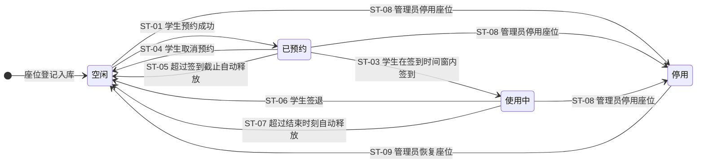

**图 SM-01 座位状态图**（建模对象：座位；关联需求：FR-02、FR-03、FR-04、FR-07）

图注：ST-02 与 ST-10 为「状态保持」记录——预约被拒绝时座位保持「空闲」，对停用座位发起预约时座位保持「停用」，均不在图中标注转换线。

| 转换编号 | 当前状态 | 触发事件 | 执行角色 | 条件或判定依据 | 目标状态及业务结果 | 失败或拒绝时处理 |
|---|---|---|---|---|---|---|
| ST-01 | 空闲 | 学生提交预约 | R-01 学生 | 账号状态允许预约；通过 BR-03—BR-06 的全部校验；目标时段座位空闲 | 状态变为「已预约」；生成「待生效」预约单；通知学生 | 提示失败原因；**状态保持「空闲」**；不生成预约单；座位不被占用 |
| ST-02 | 空闲 | 学生提交预约 | R-01 学生 | 学生处于黑名单期间（BR-13），或已有有效预约达上限（BR-04） | — | 状态保持「空闲」；拒绝预约；提示黑名单状态或当前有效预约数；不生成预约单 |
| ST-03 | 已预约 | 学生签到 | R-01 学生 | 当前时刻处于签到时间窗内（BR-07）；扫码或输入的座位号与本座位一致 | 状态变为「使用中」；预约单同步变为「使用中」；写入签到记录 | 拒绝签到；**状态保持「已预约」**；预约单保持「待签到」；不产生签到记录 |
| ST-04 | 已预约 | 学生取消预约 | R-01 学生 | 当前时刻早于预约开始时刻（BR-10） | 状态变为「空闲」；预约单变为「已取消」；不计违约 | 拒绝取消；**状态保持「已预约」**；预约单保持「待生效」；提示已过可取消时间 |
| ST-05 | 已预约 | 系统自动违约判定 | 系统定时任务 | 当前时刻已超过签到截止时刻且预约单仍为「待签到」（BR-08） | 状态变为「空闲」；预约单变为「已违约」；生成 V1 违约记录；通知学生 | 若判定前预约单已被取消或已签到，则跳过，**状态保持「已预约」**，不生成违约记录 |
| ST-06 | 使用中 | 学生签退 | R-01 学生 | 当前预约单处于「使用中」且为本人的预约 | 状态变为「空闲」；预约单变为「已完成」；记录实际使用时长 | 拒绝签退；**状态保持「使用中」**；预约单保持「使用中」；提示原因 |
| ST-07 | 使用中 | 系统自动违约判定 | 系统定时任务 | 当前时刻已超过预约结束时刻且预约单仍为「使用中」（BR-09） | 状态变为「空闲」；预约单变为「已违约」；生成 V2 违约记录；通知学生 | 若判定前学生已签退，则跳过，**状态保持「使用中」→ 已完成**，不生成违约记录 |
| ST-08 | 空闲 / 已预约 / 使用中 | 管理员停用座位 | R-02 自习室管理员 | 管理员被授权该自习室；已填写停用原因（BR-22、BR-23） | 状态变为「停用」；该座位未来有效预约被通知并自动取消，取消不记违约；写入审计日志 | 拒绝操作；**状态保持原状态**；提示越权或原因缺失；座位不进入停用 |
| ST-09 | 停用 | 管理员恢复座位 | R-02 自习室管理员 | 管理员被授权该自习室；已填写恢复说明 | 状态变为「空闲」；该座位重新可被预约；写入审计日志 | 拒绝操作；**状态保持「停用」**；提示原因；座位仍不可预约 |
| ST-10 | 停用 | 学生提交预约 | R-01 学生 | 目标座位当前为「停用」（BR-23） | — | 状态保持「停用」；拒绝预约；提示该座位暂不可预约；不生成预约单 |

### 7.2 SM-02 预约单状态

<!-- FIG:SM-02-预约单状态 -->
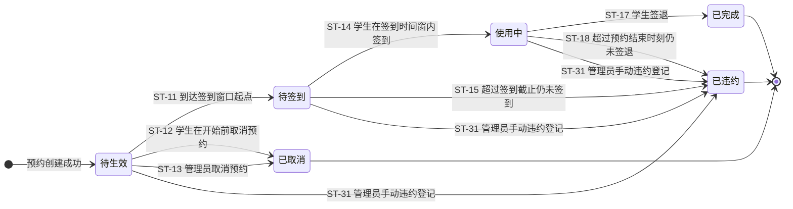

**图 SM-02 预约单状态图**（建模对象：预约单；关联需求：FR-03、FR-04、FR-05、FR-07）

图注：ST-16 为「状态保持」记录——签到被拒绝时预约单保持「待签到」，不在图中标注转换线。ST-31 是同一转换在三种当前状态下的统一入口，图中为可读性画作三条线。

| 转换编号 | 当前状态 | 触发事件 | 执行角色 | 条件或判定依据 | 目标状态及业务结果 | 失败或拒绝时处理 |
|---|---|---|---|---|---|---|
| ST-11 | 待生效 | 到达签到窗口起点 | 系统定时任务 | 当前时刻到达签到窗口起点（预约开始前 P-05 分钟），预约单未被取消 | 状态变为「待签到」；进入签到时间窗；向学生发送开始提醒 | 若预约单已取消或已违约，则跳过，状态保持「已取消」 |
| ST-12 | 待生效 | 学生取消预约 | R-01 学生 | 当前时刻早于预约开始时刻（BR-10）；预约单属于本人 | 状态变为「已取消」；座位释放为「空闲」；不计违约 | 拒绝取消；**状态保持「待生效」**；座位保持「已预约」；提示已过可取消时间 |
| ST-13 | 待生效 | 管理员取消预约 | R-02 自习室管理员 | 座位需停用，或现场情况需要腾退；已填写原因（BR-22、BR-23） | 状态变为「已取消」；座位释放为「空闲」；通知学生，取消不记违约；写入审计日志 | 拒绝操作；**状态保持「待生效」**；提示越权或原因缺失 |
| ST-14 | 待签到 | 学生签到 | R-01 学生 | 当前时刻处于签到时间窗内（BR-07）；座位号匹配 | 状态变为「使用中」；座位同步变为「使用中」；写入签到记录与签到方式 | 拒绝签到；**状态保持「待签到」**；座位保持「已预约」；提示窗口起止时间或座位不一致 |
| ST-15 | 待签到 | 系统自动违约判定 | 系统定时任务 | 当前时刻已超过签到截止时刻（BR-08） | 状态变为「已违约」；生成 V1 未签到违约记录；座位释放；累加违约次数；通知学生；达阈值时触发黑名单（ST-19） | 若判定前已签到，则跳过，状态保持「待签到」；若已存在同一事实的违约记录，则不重复生成（BR-11） |
| ST-16 | 待签到 | 学生签到 | R-01 学生 | 当前时刻早于签到窗口开始时间，或已超过签到截止时刻 | — | 状态保持「待签到」；拒绝签到；提示签到时间窗；不产生签到记录 |
| ST-17 | 使用中 | 学生签退 | R-01 学生 | 预约单处于「使用中」且属于本人 | 状态变为「已完成」；座位释放为「空闲」；记录实际使用时长；本次预约可被评价 | 拒绝签退；**状态保持「使用中」**；座位保持「使用中」；提示原因 |
| ST-18 | 使用中 | 系统自动违约判定 | 系统定时任务 | 当前时刻已超过预约结束时刻且未签退（BR-09） | 状态变为「已违约」；生成 V2 未签退违约记录；座位释放；累加违约次数；通知学生；达阈值时触发黑名单（ST-19） | 若判定前已签退，则跳过，状态保持「使用中」；同一事实不重复生成记录（BR-11） |
| ST-31 | 待生效 / 待签到 / 使用中 | 管理员手动违约登记 | R-02 自习室管理员 | 存在与该座位关联的有效预约单；已选择违约类型并填写原因（BR-11、BR-22）；该事实尚无违约记录 | 状态变为「已违约」；生成 V3 违约记录；座位释放为「空闲」；累加违约次数；通知学生；写入审计日志 | 拒绝登记；**状态保持原状态**；座位状态不变；提示原因必填或越权；同一事实已有记录时不重复生成 |

> 编号说明：ST 编号按建模对象的章节顺序连续分配。ST-01—ST-30 为 SM-01—SM-04 的基础转换；ST-31 为 SM-02 的补充转换，ST-32—ST-34 为 SM-03 的补充转换，均排在其后；SM-05 的转换 ST-35—ST-38 排在最后。

### 7.3 SM-03 用户账号状态

<!-- FIG:SM-03-账号状态 -->
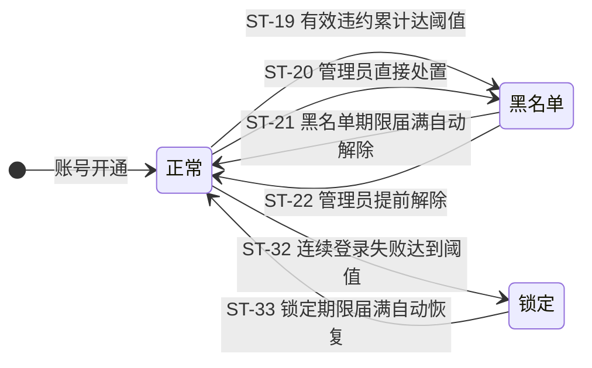

**图 SM-03 用户账号状态图**（建模对象：学生账号；关联需求：FR-01、FR-10；关联规则：BR-12、BR-13、BR-25）

图注：ST-23 为「状态保持」记录——黑名单期间发起预约被拒绝，账号保持「黑名单」。ST-34 同为「状态保持」记录——锁定期间登录被拒绝，账号保持「锁定」。「锁定」与「黑名单」互不影响：锁定只限制登录，不限制预约与签到签退；黑名单只限制发起新预约，不限制登录。ST-20 管理员直接加入与 ST-21 的延期分支本期不实现，列为后续扩展；本期仅保留自动加入、期限届满解除与提前解除（Q-28）。

| 转换编号 | 当前状态 | 触发事件 | 执行角色 | 条件或判定依据 | 目标状态及业务结果 | 失败或拒绝时处理 |
|---|---|---|---|---|---|---|
| ST-19 | 正常 | 有效违约累计达阈值 | 系统定时任务 | 有效违约累计次数达到 BR-12 规定的阈值（候选值 3 次） | 状态变为「黑名单」；记录生效时间与失效时间（候选值 7 天）；禁止发起新预约；通知本人；写入审计日志 | 若累计次数未达阈值，则**状态保持「正常」**，不限制预约权限 |
| ST-20 | 正常 | 管理员直接处置（本期不实现，列为后续；Q-28） | R-02 自习室管理员 | 存在严重违规事实（如现场拒不配合、冒用他人座位）；已填写处置原因（BR-22） | 状态变为「黑名单」；记录期限与原因；禁止发起新预约；通知本人；写入审计日志 | 拒绝操作；**状态保持「正常」**；提示原因必填或越权；不限制预约权限 |
| ST-21 | 黑名单 | 黑名单期限届满（延期本期不实现，Q-28） | 系统定时任务 | 当前时刻达到记录的失效时间，且无延期（延期分支列为后续） | 状态变为「正常」；恢复预约权限；通知本人；写入审计日志 | 若已被管理员延期，则**状态保持「黑名单」**，按新失效时间继续计算（延期分支后续） |
| ST-22 | 黑名单 | 管理员提前解除 | R-02 自习室管理员 | 管理员被授权；已填写解除原因（BR-22）；申诉或特殊情况成立 | 状态变为「正常」；恢复预约权限；通知本人；写入审计日志 | 拒绝操作；**状态保持「黑名单」**；提示原因必填或越权 |
| ST-23 | 黑名单 | 学生提交预约 | R-01 学生 | 账号处于黑名单期间（BR-13） | — | 状态保持「黑名单」；拒绝预约；提示剩余解除时间与解除条件；不生成预约单 |
| ST-32 | 正常 | 连续登录失败达到阈值 | 系统（登录校验） | 同一账号连续登录失败次数达到 BR-25 规定的阈值（候选值 5 次） | 状态变为「锁定」；记录锁定开始时间与自动解锁时间（候选值 15 分钟）；拒绝该账号继续登录；通知本人；写入审计日志 | 若未达阈值，则**状态保持「正常」**；累计失败次数继续累加；不锁定账号 |
| ST-33 | 锁定 | 锁定期限届满 | 系统定时任务 | 当前时刻达到锁定的自动解锁时间 | 状态变为「正常」；转发失败次数计数清零；恢复登录；通知本人；写入审计日志 | 若管理员已延长锁定期限，则**状态保持「锁定」**，按新的解锁时间继续计算 |
| ST-34 | 锁定 | 用户提交登录 | R-01 学生、R-02 自习室管理员、R-03 系统管理员 | 账号处于锁定期间（BR-25） | — | 状态保持「锁定」；拒绝登录；提示锁定剩余时间；不建立会话；已有的预约与签到签退不受影响 |

### 7.4 SM-04 投诉单状态

<!-- FIG:SM-04-投诉单状态 -->
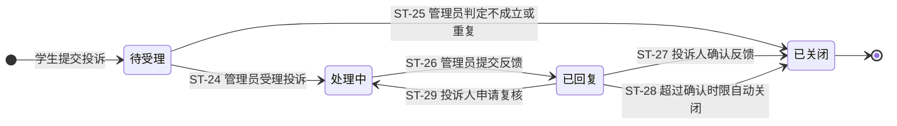

**图 SM-04 投诉单状态图**（建模对象：投诉单；关联需求：FR-09；关联规则：BR-15、BR-16、BR-17）

图注：ST-30 为「状态保持」记录——超过受理时限未处理时投诉单保持「待受理」。ST-25 不成立关闭、ST-27 投诉人确认关闭与 ST-30 超期提醒本期不实现，列为后续扩展；本期只保留受理、反馈、复核与自动关闭（Q-17、Q-30、Q-31）。

| 转换编号 | 当前状态 | 触发事件 | 执行角色 | 条件或判定依据 | 目标状态及业务结果 | 失败或拒绝时处理 |
|---|---|---|---|---|---|---|
| ST-24 | 待受理 | 管理员受理投诉 | R-02 自习室管理员 | 管理员已登录；投诉单未被关闭；投诉对象不属于本人（BR-15、BR-21） | 状态变为「处理中」；记录受理时间与处理人；通知投诉人已受理 | 拒绝受理；**状态保持「待受理」**；提示越权或投诉对象需回避；不记录受理时间 |
| ST-25 | 待受理 | 管理员判定不成立或重复（本期不实现，列为后续；Q-31） | R-02 自习室管理员 | 投诉内容经核实不成立，或与已有投诉单重复；须填写判定理由 | 状态变为「已关闭」；记录判定理由与关闭时间；通知投诉人；写入审计日志 | 拒绝关闭；**状态保持「待受理」**；提示理由必填；投诉单仍待处理 |
| ST-26 | 处理中 | 管理员提交反馈 | R-02 自习室管理员 | 已完成调查；反馈内容非空 | 状态变为「已回复」；反馈内容对投诉人可见；通知投诉人；写入审计日志 | 拒绝提交；**状态保持「处理中」**；提示反馈内容必填 |
| ST-27 | 已回复 | 投诉人确认反馈（本期不实现，列为后续；Q-31） | R-01 学生 | 反馈已提交且投诉单属于本人 | 状态变为「已关闭」；记录关闭时间与确认方式；写入审计日志 | 拒绝确认；**状态保持「已回复」**；提示无权操作 |
| ST-28 | 已回复 | 超过确认时限 | 系统定时任务 | 反馈提交后超过确认时限（候选值 3 个自然日）且投诉人未确认、未申请复核 | 状态变为「已关闭」；记录自动关闭时间；通知投诉人 | 若投诉人已申请复核，则**状态保持「已回复」**并转入 ST-29 |
| ST-29 | 已回复 | 投诉人申请复核 | R-01 学生 | 反馈后 3 个自然日内（候选值）且尚未申请过复核（BR-17） | 状态变为「处理中」；复核标记置为已使用；通知管理员重新处理 | 拒绝复核；**状态保持「已回复」**；提示已超出复核期或已申请过复核 |
| ST-30 | 待受理 | 管理员受理投诉（本期不执行超期提醒；Q-17、Q-30） | 系统定时任务 | 提交后超过受理时限（候选值 2 个工作日）仍未受理（BR-16） | — | 状态保持「待受理」；投诉单可继续被受理。超期提醒本期不执行（Q-17、Q-30） |

### 7.5 SM-05 违约记录状态

<!-- FIG:SM-05-违约记录状态 -->
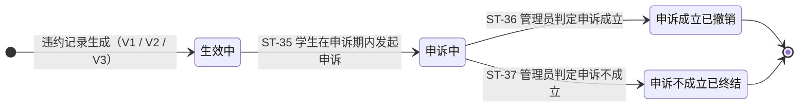

**图 SM-05 违约记录状态图**（建模对象：违约记录；关联需求：FR-05、FR-07；关联规则：BR-11、BR-14）

图注：ST-38 为「状态保持」记录——超过申诉期或该记录已申诉过时，再次申诉被拒绝，记录保持「生效中」。仅「生效中」状态参与有效违约次数累计；「申诉中」期间记录保持生效并继续计数，计数回退只在申诉成立（ST-36）时发生。

| 转换编号 | 当前状态 | 触发事件 | 执行角色 | 条件或判定依据 | 目标状态及业务结果 | 失败或拒绝时处理 |
|---|---|---|---|---|---|---|
| ST-35 | 生效中 | 学生发起申诉 | R-01 学生 | 记录属于本人；距记录生成时间未超过申诉期（BR-14，候选值 3 个自然日）；该记录尚未申诉过 | 状态变为「申诉中」；记录申诉发起时间与申诉理由；通知管理员待复核 | 拒绝申诉；**状态保持「生效中」**；提示不可申诉的原因；记录与有效违约计数均不变 |
| ST-36 | 申诉中 | 管理员判定申诉成立 | R-02 自习室管理员 | 申诉理由经核实成立（如签到设备故障、系统判定有误）；已填写判定结论 | 状态变为「申诉成立已撤销」；该记录不再参与有效违约次数累计并回退计数；账号状态按回退后的计数重算（可能由「黑名单」回到「正常」，见 ST-22）；通知学生；写入审计日志 | 拒绝处置；**状态保持「申诉中」**；提示结论必填或越权；记录与计数均不变 |
| ST-37 | 申诉中 | 管理员判定申诉不成立 | R-02 自习室管理员 | 申诉理由经核实不成立；已填写判定结论 | 状态变为「申诉不成立已终结」；记录保持有效并继续参与累计；通知学生；写入审计日志 | 拒绝处置；**状态保持「申诉中」**；提示结论必填或越权；记录与计数均不变 |
| ST-38 | 生效中 | 学生发起申诉 | R-01 学生 | 距记录生成时间已超过申诉期，或该记录此前已申诉过（BR-14） | — | 状态保持「生效中」；拒绝申诉；提示已超出申诉期或已申诉过；记录与有效违约计数均不变 |

---

## 8 活动流程

### 8.1 AD-01 座位预约主流程

<!-- FIG:AD-01-预约主流程 -->
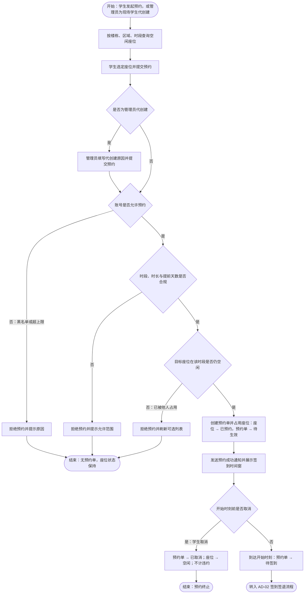

**图 AD-01 座位预约主流程**（建模对象：从发起预约到进入签到阶段的完整流程；关联需求：FR-03、FR-04、FR-12；关联转换：ST-01、ST-02、ST-04、ST-11、ST-12；覆盖用例：UC-03、UC-04、UC-05）

图注：admin 代创建分支对应 UC-04 的备选流 A6，创建来源记为「管理员代创建」并写入审计日志（BR-22）；该分支本期不实现，列为后续扩展（Q-26）。

### 8.2 AD-02 签到与签退流程

<!-- FIG:AD-02-签到签退 -->
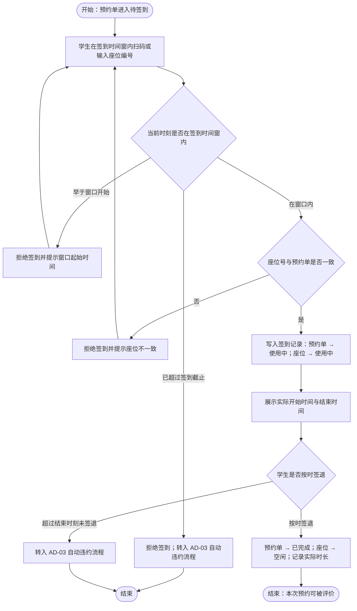

**图 AD-02 签到与签退流程**（建模对象：签到与签退的完整流程；关联需求：FR-04；关联转换：ST-03、ST-06、ST-07、ST-14、ST-16、ST-17；覆盖用例：UC-06、UC-07）

### 8.3 AD-03 自动违约处理流程

<!-- FIG:AD-03-自动违约处理 -->
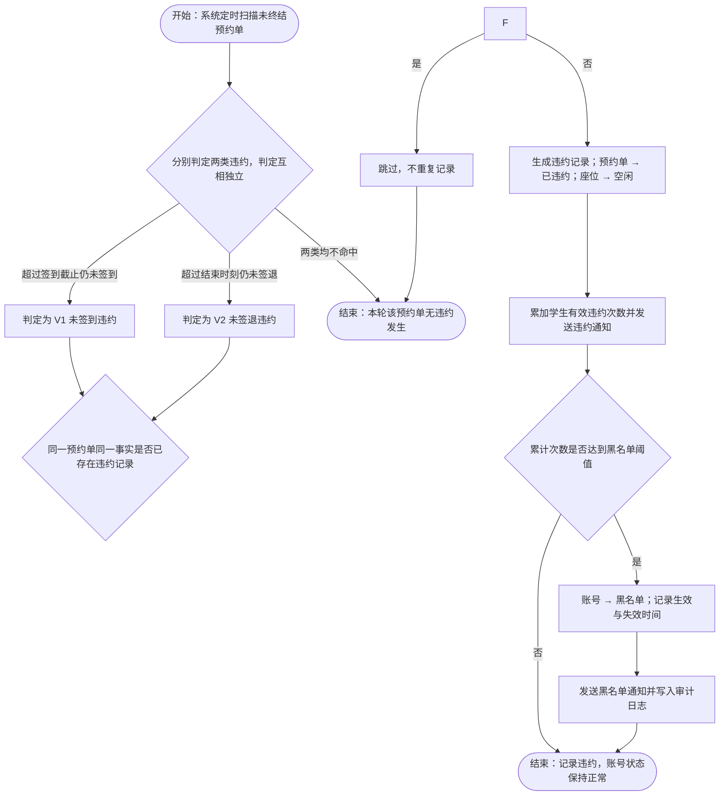

**图 AD-03 自动违约处理流程**（建模对象：系统自动判定违约并触发黑名单的流程；关联需求：FR-05、FR-10、FR-12；关联转换：ST-05、ST-07、ST-15、ST-18、ST-19；覆盖用例：UC-08、UC-13）

图注：V1 与 V2 两类判定分别扫描，但同一预约单只生成首条违约后终结，不生成 V1+V2 双记录（对应 UC-08 主流程第 3 步，Q-35）；生成的违约记录初始状态为「生效中」，其后续处置见 7.5 SM-05 违约记录状态。

### 8.4 AD-04 投诉处理流程

<!-- FIG:AD-04-投诉处理 -->
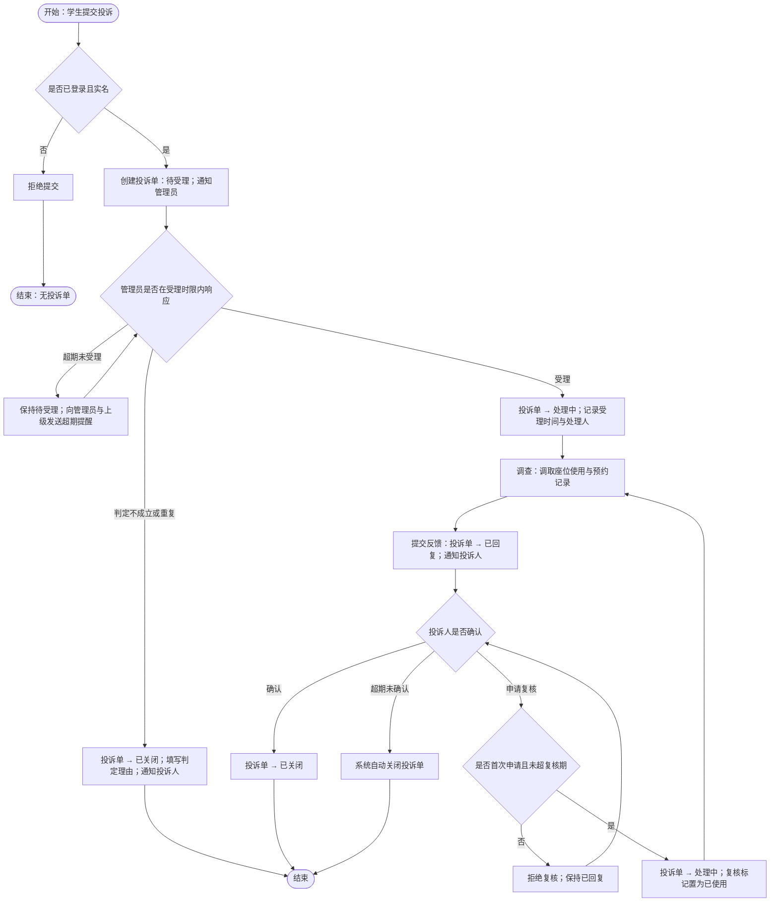

**图 AD-04 投诉处理流程**（建模对象：投诉从提交到关闭的完整流程；关联需求：FR-09、FR-12；关联转换：ST-24 至 ST-30；覆盖用例：UC-11）

---

## 9 数据需求

### 9.1 领域类图

<!-- FIG:CD-01-领域类图 -->
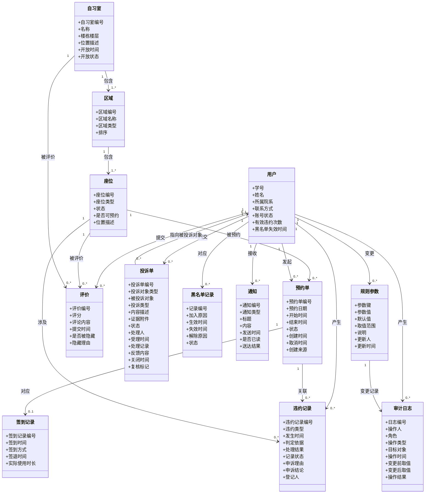

**图 CD-01 领域类图**（建模对象：系统领域实体及其关联；关联需求：FR-02—FR-14）

### 9.2 数据字典

| 实体编号 | 实体名称 | 主要属性 | 关键约束 | 关联需求 |
|---|---|---|---|---|
| DM-01 | 自习室 | 自习室编号、名称、楼栋楼层、位置描述、开放时间、开放状态、备注 | 自习室编号唯一；开放状态取值：开放 / 关闭 | FR-02 |
| DM-02 | 区域 | 区域编号、所属自习室编号、区域名称、区域类型、排序 | 区域编号唯一；同一自习室内区域名称不重复 | FR-02 |
| DM-03 | 座位 | 座位编号、所属区域编号、座位类型、状态、是否可预约、位置描述 | 座位编号唯一；状态取值：空闲 / 已预约 / 使用中 / 停用 | FR-02、FR-07 |
| DM-04 | 用户 | 学号、姓名、所属院系、联系方式、账号状态、锁定解锁时间、有效违约次数、黑名单失效时间 | 学号唯一且与统一身份认证一致；账号状态取值：正常 / 黑名单 / 锁定；连续登录失败次数与锁定解锁时间仅用于锁定判定 | FR-01、FR-08、FR-10 |
| DM-05 | 预约单 | 预约单编号、学号、座位编号、预约日期、开始时间、结束时间、状态、创建时间、取消时间、创建来源 | 预约单编号唯一；结束时间晚于开始时间；状态取值：待生效 / 待签到 / 使用中 / 已完成 / 已取消 / 已违约 | FR-03、FR-04 |
| DM-06 | 签到记录 | 签到记录编号、预约单编号、签到时间、签到方式、签退时间、实际使用时长 | 一条预约单最多对应一条签到记录；签退时间晚于签到时间 | FR-04 |
| DM-07 | 违约记录 | 违约记录编号、学号、预约单编号（V3 可为空）、座位编号、违约类型、发生时间、判定依据、处理结果、记录状态、申诉理由、申诉结论、登记人 | 违约类型取值：V1 未签到 / V2 未签退 / V3 管理员手动登记；记录状态取值与 7.5 SM-05 一致：生效中 / 申诉中 / 申诉成立已撤销 / 申诉不成立已终结；仅「生效中」与「申诉中」参与有效违约次数累计 | FR-05、FR-07 |
| DM-08 | 评价 | 评价编号、学号、被评价对象类型、被评价对象编号、评分、评论内容、提交时间、是否被隐藏、隐藏理由 | 评分取值 1—5 的整数；同一学生对同一对象仅一条有效评价 | FR-08 |
| DM-09 | 投诉单 | 投诉单编号、投诉人学号、投诉对象类型、被投诉对象、投诉类型、内容描述、证据附件、状态、处理人、受理时间、处理记录、反馈内容、关闭时间、复核标记 | 投诉对象类型取值：座位或自习室 / 其他用户 / 管理员；状态取值：待受理 / 处理中 / 已回复 / 已关闭；复核标记最多使用一次 | FR-09 |
| DM-10 | 黑名单记录 | 记录编号、学号、加入原因、来源（自动 / 管理员）、生效时间、失效时间、解除原因、状态 | 同一学生同一时间最多一条生效中的黑名单记录 | FR-10 |
| DM-11 | 通知 | 通知编号、接收人学号、通知类型、标题、内容、发送时间、是否已读、送达结果 | 通知类型取值见 FR-12；通知不可被删除 | FR-12 |
| DM-12 | 规则参数 | 参数键、参数值、默认值、取值范围、说明、更新人、更新时间 | 参数键唯一；参数值须落在声明范围内 | FR-13 |
| DM-13 | 审计日志 | 日志编号、操作人、角色、操作类型、目标对象、操作时间、变更前取值、变更后取值、操作结果 | 日志不可修改与删除；变更前后取值须同时记录 | FR-14 |

### 9.3 关键数据关系与状态对应

| 关系 | 数量关系 | 说明 | 关联转换 |
|---|---|---|---|
| 自习室—区域 | 1 : 1..* | 一个自习室包含多个区域 | — |
| 区域—座位 | 1 : 1..* | 一个区域包含多个座位 | — |
| 座位—预约单 | 1 : 0..* | 一个座位在不同时段可有多条预约单，同一时段至多一条有效预约单 | ST-01、ST-04 |
| 预约单—签到记录 | 1 : 0..1 | 仅签到过的预约单有签到记录 | ST-03、ST-14 |
| 用户—违约记录 | 1 : 0..* | 有效违约记录参与累计计数 | ST-15、ST-18、ST-19 |
| 用户—黑名单记录 | 1 : 0..* | 生效中的黑名单记录决定账号状态 | ST-19—ST-23 |
| 用户—评价 | 1 : 0..* | 须存在已完成预约方可评价 | ST-17 |
| 座位—违约记录 | 1 : 0..* | V1、V2、V3 三类违约记录均可关联到具体座位 | ST-15、ST-18、ST-31 |
| 违约记录—用户 | 1 : 1 | 每条违约记录归属于一名学生，申诉与计数回退按学生维度处理 | ST-35、ST-36 |
| 用户—账号状态 | 1 : 1 | 账号状态由有效违约计数（黑名单）与登录失败计数（锁定）分别驱动 | ST-19—ST-23、ST-32—ST-34 |

---

## 10 权限矩阵

图例：**✓** 允许；**◑** 仅限本人或本人被授权范围；**▣** 允许但须填写原因并留痕；**—** 禁止。

| 序号 | 操作 | R-01 学生 | R-02 自习室管理员 | R-03 系统管理员 | R-04 后勤部门 | 关联需求 |
|---|---|---|---|---|---|---|
| 1 | 登录并进入本角色工作台 | ✓ | ✓ | ✓ | ✓ | FR-01 |
| 2 | 查看与修改本人联系方式 | ✓ | ✓ | ✓ | ◑ | FR-08 |
| 3 | 查询座位可用情况 | ✓ | ✓ | ✓ | ✓ | FR-06 |
| 4 | 提交座位预约 | ✓ | ▣ | — | — | FR-03 |
| 5 | 取消本人预约 | ◑ | ▣ | — | — | FR-04 |
| 6 | 签到 | ◑ | — | — | — | FR-04 |
| 7 | 签退 | ◑ | — | — | — | FR-04 |
| 8 | 查询预约记录 | ◑ | ◑ | ✓ | ✓ | FR-06 |
| 9 | 查询违约记录 | ◑ | ◑ | ✓ | — | FR-06 |
| 10 | 对违约记录发起申诉 | ◑ | — | — | — | FR-05 |
| 11 | 提交投诉 | ✓ | — | — | — | FR-09 |
| 12 | 查看投诉进展与反馈 | ◑ | ◑ | ✓ | — | FR-09 |
| 13 | 提交评价 | ◑ | — | — | — | FR-08 |
| 14 | 查看本人黑名单状态 | ◑ | ◑ | ✓ | — | FR-10 |
| 15 | 维护自习室、区域、座位基础信息 | — | ◑ | ✓ | — | FR-02 |
| 16 | 停用与恢复座位 | — | ◑ ▣ | ✓ ▣ | — | FR-02 |
| 17 | 实时座位视图 | — | ◑ | ✓ | — | FR-07 |
| 18 | 手动违约登记 | — | ◑ ▣ | — | — | FR-07 |
| 19 | 查看座位使用与预约记录 | — | ◑ | ✓ | ✓ | FR-07 |
| 20 | 受理、回复与关闭投诉 | — | ◑ | ✓ | — | FR-09 |
| 21 | 查询、解除、延期黑名单 | — | ◑ ▣ | ✓ ▣ | — | FR-10 |
| 22 | 查看数据分析页面 | — | ◑ | ✓ | ✓ | FR-11 |
| 23 | 导出统计数据 | — | ◑ | ✓ | ✓ | FR-11 |
| 24 | 配置开放时间与规则参数 | — | — | ✓ ▣ | — | FR-13 |
| 25 | 查询审计日志 | — | — | ✓ | — | FR-14 |
| 26 | 查看其他用户的个人信息 | — | — | ✓ | — | FR-08 |
| 27 | 隐藏或恢复违规评价 | — | ◑ ▣ | ✓ ▣ | — | FR-08、BR-19 |
| 28 | 查看本人通知并标记已读 | ◑ | ◑ | ◑ | — | FR-12 |
| 29 | 提前释放座位或管理员取消预约 | — | ◑ ▣ | — | — | FR-07、ST-13 |
| 30 | 审核违约申诉（判定成立或不成立） | — | ◑ ▣ | ✓ ▣ | — | FR-05、BR-14、ST-36、ST-37 |
| 31 | 直接修改座位状态 | — | — | — | — | FR-02、BR-02 |
| 32 | 直接修改或删除预约、违约、审计记录 | — | — | — | — | BR-24 |

**矩阵说明**：

1. 第 31、32 行为明确的禁止项：座位状态只能由业务流程（预约、签到、签退、自动违约）驱动变更，任何角色都不能手工直接改写；预约、违约与审计记录一律不可修改与删除。管理员纠正误判的合法路径是申诉复核或重新登记，且须留痕。
2. 第 20 行投诉处理中，投诉对象为管理员本人的强制回避与上级仲裁列为后续扩展；本期由组长/系统管理员人工协调（Q-10、Q-29）。
3. 需求编号 FR-11 上，后勤部门为只读角色，不得发起任何写入操作。
4. 所有标记为 **▣** 的操作必须填写原因，并将操作人、时间、目标对象与前后状态写入审计日志（BR-22、BR-24）。
5. 第 27 行的评价隐藏与恢复仅能由管理员执行，且必须填写理由；被隐藏的评价不参与平均分计算（BR-19）。第 28 行中，学生与管理员只能查看与标记本人的通知；后勤部门无通知查看权限，因为其不参与预约业务。第 29 行的提前释放座位与管理员取消预约等价于对预约单执行 ST-13，须填写原因并写入审计日志。第 30 行的申诉审核只允许判定「成立」或「不成立」，不允许直接删除违约记录；判定成立时按 ST-36 回退有效违约计数。第 31、32 行为禁止项，任何角色均不可执行。
6. 上述权限一律由服务端校验，前端仅作呈现优化（BR-21）。越权请求返回明确的拒绝结果，同时不产生任何数据变更。

---

## 11 质量要求（非功能需求）

| 编号 | 质量属性 | 要求 | 验证方式 | 来源性质 | 候选值状态 |
|---|---|---|---|---|---|
| NFR-01 | 实时性 | 数据分析页面的图表与统计数值每 10 秒自动刷新一次，刷新方式为局部更新，不进行整页重载 | 观察页面在网络面板中的数据请求周期 | 原始资料 | 已给定，非候选 |
| NFR-02 | 性能 | 常规查询（座位查询、记录查询）在正常负载下响应时间不超过 2 秒 | 压力与响应时间测试 | AI 候选 | 待确认 |
| NFR-03 | 时效性 | 超过签到截止或结束时刻后，生成违约记录与释放座位的延迟不超过 1 分钟；扫描间隔参数 P-15 的取值范围为 10—60 秒（Q-18） | 定时扫描间隔配置核查 + 场景测试 | AI 候选 | 组内教学模拟已决定（2026-11-12） |
| NFR-04 | 并发能力 | 支持同时在线用户不少于 500 人；预约提交峰值吞吐不低于 50 次/秒 | 并发压测 | AI 候选 | 待确认 |
| NFR-05 | 数据一致性 | 同一座位同一时段的并发预约请求中，成功创建预约单的数量不超过 1；座位状态变更与预约单写入在同一事务内完成 | 并发抢座测试 | 分析推导 | 待确认 |
| NFR-06 | 可用性 | 服务可用率不低于 99.5%；数据刷新功能在服务降级时提供最近一次成功数据并明确标注时间 | 可用性监控与降级演练 | AI 候选 | 待确认 |
| NFR-07 | 安全—权限 | 所有涉及数据读写的接口在服务端完成角色与数据归属校验；越权请求被拒绝且不产生副作用 | 越权用例测试（含跨用户、跨自习室） | 分析推导 | 团队已复核 |
| NFR-08 | 安全—身份 | 登录通过校内统一身份认证完成；会话在连续 30 分钟无操作后失效；连续登录失败达到阈值时临时锁定 | 会话与登录测试 | AI 候选 | 待确认 |
| NFR-09 | 隐私保护 | 手机号、邮箱等在列表与投诉单中脱敏展示；被投诉人的个人信息对投诉人不可见；导出数据不含与业务无关的个人信息 | 页面与导出内容核查 | 分析推导 | 团队已复核 |
| NFR-10 | 易用性 | 预约主流程的操作步数不超过 3 步；签到方式不超过 2 种；关键处置操作（手动违约、黑名单解除、座位停用）提供前端二次确认；服务端单会话与服务端二次确认列为后续扩展（Q-37），前端 confirm 不构成服务端安全边界 | 任务走查与步数统计 | AI 候选 | 组内教学模拟已决定（2026-11-12，部分满足） |
| NFR-11 | 兼容性 | 支持主流浏览器最近两个大版本；签到页面适配移动端浏览器，可在手机端完成扫码签到 | 浏览器与移动端测试 | 分析推导 | 待确认 |
| NFR-12 | 可维护性 | 业务规则中的全部数值参数可在后台配置并即时生效，调整参数不需要修改程序与重新部署 | 参数变更验证 | AI 候选 | 团队已复核 |
| NFR-13 | 可测试性 | 核心业务规则（预约校验、违约判定、黑名单触发、状态转换）可独立测试，不依赖真实统一身份认证；提供标准测试数据的构造方式 | 测试方案与用例执行 | 分析推导 | 团队已复核 |
| NFR-14 | 数据保留 | 预约记录保留 2 年；违约记录保留 2 年；投诉单保留 2 年；审计日志保留 2 年 | 保留策略核查 | AI 候选 | 待确认 |
| NFR-15 | 备份与恢复 | 业务数据每日备份一次；恢复时间目标不超过 4 小时；恢复点目标不超过 24 小时 | 备份记录与恢复演练 | AI 候选 | 待确认 |
| NFR-16 | 日志完整性 | 权限矩阵中标记为 **▣** 的操作 100% 产生审计日志，日志包含变更前后取值 | 日志抽样核查 | 分析推导 | 团队已复核 |
| NFR-17 | 错误处理 | 所有失败路径向用户给出可理解的原因说明；不得向用户暴露内部异常、堆栈或数据库信息 | 异常场景走查 | 分析推导 | 团队已复核 |
| NFR-18 | 时间一致性 | 签到、违约判定等与时间强相关的判定统一以服务端时间为准，不采用客户端时间 | 时间相关场景测试 | 分析推导 | 团队已复核 |

> 口径说明（V1.4）：NFR-02/04/06 的 2 秒、500 人、50 次每秒、99.5% 仅作演示目标，不作为验收阈值（Q-20；Q-23 待教师确认）。NFR-14/15 本期为演示口径，不实现备份/清理/恢复演练（Q-21）。

---

## 12 异常场景

| 编号 | 异常场景 | 提示与处置方式 | 数据与状态结果 | 关联需求 |
|---|---|---|---|---|
| EX-01 | 学生重复点击提交导致同一时段多次预约请求 | 前端按钮置为提交中并禁用；本期不加服务端幂等键，依赖同时有效预约上限、座位时段唯一约束与前端禁用重复提交，最多创建一条预约单；幂等键列为后续补充（Q-36） | 仅生成 1 条有效预约单；其余请求返回同一结果或明确提示已预约 | FR-03、BR-04 |
| EX-02 | 两名学生并发预约同一座位同一时段 | 服务端对座位时段加锁或采用唯一约束；后到达的请求被拒绝并提示座位状态已变化 | 仅 1 条预约单创建成功；座位状态变为「已预约」；失败方状态保持「空闲」 | FR-03、NFR-05、ST-01、ST-02 |
| EX-03 | 签到失败（二维码损坏、输入座位号有误） | 提示具体原因（座位号不匹配、座位号不存在）；引导学生重新扫码或核对座位号，或联系管理员 | 预约单保持「待签到」；座位保持「已预约」；不产生签到记录 | FR-04、ST-16 |
| EX-04 | 学生使用后忘记签退 | 超时自动判定为 V2 未签退违约并释放座位；提前在结束前发送签退提醒 | 预约单变为「已违约」；座位释放为「空闲」；生成 V2 违约记录并累加次数 | FR-04、FR-05、BR-09、ST-07、ST-18 |
| EX-05 | 学生扫码时网络中断，签到结果未确认 | 请求失败时提示网络异常并保留在原页面；学生可重新提交；服务端已成功写入的签到记录不因客户端未收到响应而回滚 | 若服务端已写入：预约单为「使用中」；若未写入：状态保持「待签到」 | FR-04、NFR-07 |
| EX-06 | 管理员误将正常座位停用 | 停用操作须填写原因并二次确认；误操作可通过「恢复座位」纠正；该座位被自动取消的预约不记违约并通知学生 | 座位经历「停用 → 空闲」；被取消的预约单为「已取消」；两次操作均写入审计日志 | FR-02、FR-07、BR-23、ST-08、ST-09 |
| EX-07 | 管理员误登记违约 | 手动违约登记须二次确认并填写原因；学生可对该记录发起申诉；申诉成立时撤销违约记录并回退计数 | 申诉成立：违约记录依次转为「申诉中」与「申诉成立已撤销」，计数回退，账号状态按最新计数重算；申诉不成立：记录转为「申诉不成立已终结」并保持有效 | FR-05、FR-07、BR-14、ST-31、ST-35、ST-36、ST-37 |
| EX-08 | 恶意或重复投诉 | 同一投诉人对同一对象、同一事实的重复投诉被合并或拒绝；内容明显违规的投诉可被直接判定不成立并关闭，须填写理由 | 投诉单直接进入「已关闭」；填写判定理由；不产生额外处理负担 | FR-09、BR-15、ST-25 |
| EX-09 | 投诉超过受理时限仍未处理 | 投诉单保持「待受理」；向管理员与其上级发送超期提醒；投诉人可见「已超期」标记 | 投诉单状态保持「待受理」；不产生反馈；超期事实写入审计日志 | FR-09、BR-16、ST-30 |
| EX-10 | 座位被停用时该座位已存在未来有效预约 | 系统通知受影响学生并自动取消其预约；取消不记违约 | 受影响预约单变为「已取消」；座位变为「停用」；不计违约、不计入黑名单 | FR-02、BR-23、ST-08、ST-13 |
| EX-11 | 学生被加入黑名单时仍持有有效预约 | 黑名单期间的处置规则见 Q-05，当前按候选方案处理：禁止发起新预约，当日已生效预约允许签到与签退 | 账号变为「黑名单」；已有预约按 Q-05 结论处理；该规则待确认 | FR-10、BR-13、ST-19 |
| EX-12 | 服务端时间异常导致违约误判 | 约定以统一时钟源为准并监控时间偏移；发现异常时暂停自动违约判定并告警，待时间恢复后重新判定 | 暂停期间不生成违约记录；已生成的可经申诉撤销 | FR-05、NFR-18 |
| EX-13 | 统一身份认证服务不可用 | 登录页提示认证服务暂不可用并保留重试入口；已登录用户的会话在有效期内可继续使用 | 无法建立新会话；已有业务数据不受影响 | FR-01、NFR-06 |

---

## 13 验收标准

验收标准采用 Given（前置条件）—When（操作）—Then（预期结果）形式，编号格式为 AC-功能需求序号-序号。

### 13.1 账号与访问

| 编号 | 关联 | Given | When | Then | 关联规则/转换 |
|---|---|---|---|---|---|
| AC-01-01 | US-01、FR-01 | 学生已持有校内统一身份认证账号 | 使用学号完成认证 | 建立会话并进入学生工作台，页面上不出现管理类操作入口 | BR-21 |
| AC-01-02 | FR-01 | 用户以管理员身份登录 | 查看工作台 | 呈现座位资源维护、实时座位视图、投诉处理、黑名单管理等管理类入口 | BR-21 |
| AC-01-03 | FR-01 | 学生已登录 | 通过直接请求发起管理类操作（如手动违约登记） | 服务端拒绝该请求并返回明确的越权提示，同时不产生任何数据变更 | BR-21、NFR-07 |
| AC-01-04 | FR-01、BR-25 | 某账号连续登录失败达到候选阈值 5 次 | 系统处理，随后该账号再次尝试登录 | 账号进入「锁定」并记录自动解锁时间；锁定期间登录被拒绝并提示剩余解锁时间；锁定期满自动恢复为「正常」；锁定不影响该账号已有的预约与签到签退 | BR-25、ST-32、ST-33、ST-34 |

### 13.2 资源管理

| 编号 | 关联 | Given | When | Then | 关联规则/转换 |
|---|---|---|---|---|---|
| AC-02-01 | US-14、FR-02 | 管理员已被授权自习室 A | 新增区域与座位并填写属性 | 区域与座位创建成功，属性完整保存，且归属于自习室 A | BR-01 |
| AC-02-02 | FR-02、BR-02 | 座位处于「空闲」 | 任何角色尝试手工直接改写座位状态 | 请求被拒绝，座位状态保持「空闲」 | BR-02、权限矩阵第 31 行 |
| AC-02-03 | FR-02 | 管理员只被授权自习室 A | 尝试修改自习室 B 的座位 | 请求被拒绝并提示越权，自习室 B 的座位保持不变 | BR-21 |
| AC-02-04 | FR-02 | 座位处于「空闲」，且有 1 条未来有效预约 | 管理员停用该座位 | 座位变为「停用」，该未来预约被取消并通知学生，取消不计违约，操作写入审计日志 | BR-23、BR-22、ST-08、ST-13 |

### 13.3 预约

| 编号 | 关联 | Given | When | Then | 关联规则/转换 |
|---|---|---|---|---|---|
| AC-03-01 | US-03、FR-03 | 学生账号正常、无有效预约、时段在开放时间内、目标座位空闲 | 提交预约 | 生成「待生效」预约单，座位变为「已预约」，学生收到预约成功通知 | BR-03—BR-06、ST-01 |
| AC-03-02 | FR-03 | 学生处于黑名单期间 | 提交预约 | 预约被拒绝，提示黑名单状态与剩余解除时间，座位保持「空闲」，不生成预约单 | BR-13、ST-02、ST-23 |
| AC-03-03 | FR-03 | 学生已持有 1 条有效预约 | 再次提交预约 | 预约被拒绝并提示当前有效预约与上限，座位保持「空闲」 | BR-04、ST-02 |
| AC-03-04 | FR-03 | 学生选择时长 6 小时或提前 10 天预约 | 提交预约 | 预约被拒绝并提示允许的时长区间与提前天数上限 | BR-05、BR-06、ST-02 |
| AC-03-05 | FR-03、NFR-05 | 两名学生对同一座位同一时段并发提交预约 | 请求同时到达 | 仅 1 条预约单创建成功，其余请求被拒绝并提示座位状态已变化 | BR-03、ST-01、ST-02 |

### 13.4 使用过程

| 编号 | 关联 | Given | When | Then | 关联规则/转换 |
|---|---|---|---|---|---|
| AC-04-01 | US-04、FR-04 | 预约单为「待生效」，当前早于开始时刻 | 学生取消预约 | 预约单变为「已取消」，座位回到「空闲」，不生成违约记录 | BR-10、ST-04、ST-12 |
| AC-04-02 | FR-04 | 预约单为「待签到」，当前已过开始时刻 | 学生尝试取消 | 取消被拒绝，提示已过可取消时间，预约单保持「待签到」 | BR-10、ST-12 |
| AC-04-03 | US-05、FR-04 | 预约单为「待签到」，当前处于签到时间窗内 | 学生扫码签到 | 预约单变为「使用中」，座位变为「使用中」，写入签到时间与方式 | BR-07、ST-03、ST-14 |
| AC-04-04 | FR-04 | 预约单为「待签到」，当前早于签到窗口开始时间 | 学生尝试签到 | 签到被拒绝并提示窗口开始时间，预约单保持「待签到」，座位保持「已预约」 | BR-07、ST-16 |
| AC-04-05 | US-06、FR-04 | 预约单为「使用中」 | 学生签退 | 预约单变为「已完成」，座位回到「空闲」，记录实际使用时长 | ST-06、ST-17 |
| AC-04-06 | FR-04 | 学生扫码的座位号与本人预约单座位不一致 | 提交签到 | 签到被拒绝并提示座位不一致，状态保持不变 | ST-16 |

### 13.5 违约与信用

| 编号 | 关联 | Given | When | Then | 关联规则/转换 |
|---|---|---|---|---|---|
| AC-05-01 | FR-05、BR-08 | 预约单为「待签到」，当前已超过签到截止时刻 | 系统执行定时扫描 | 预约单变为「已违约」，生成 V1 未签到违约记录，座位释放为「空闲」，学生收到通知 | BR-08、ST-05、ST-15 |
| AC-05-02 | FR-05、BR-09 | 预约单为「使用中」，当前已超过预约结束时刻 | 系统执行定时扫描 | 预约单变为「已违约」，生成 V2 未签退违约记录，座位释放为「空闲」 | BR-09、ST-07、ST-18 |
| AC-05-03 | US-09、FR-05 | 存在「生效中」的违约记录，且在申诉期内 | 学生发起申诉且管理员判定成立 | 违约记录依次转为「申诉中」与「申诉成立已撤销」；该记录不再参与有效违约计数并回退计数；申诉结论与操作人写入审计日志 | BR-14、ST-35、ST-36 |
| AC-05-04 | FR-05 | 违约记录已超过申诉期，或该记录已申诉过 | 学生再次发起申诉 | 申诉被拒绝并提示不可申诉的原因，记录保持「生效中」，记录与有效违约计数均不变 | BR-14、ST-38 |
| AC-05-05 | FR-10、BR-12 | 学生有效违约计数为阈值减 1 | 新增 1 条有效违约记录 | 计数达到阈值，账号自动进入黑名单，记录生效与失效时间，学生收到通知 | BR-12、ST-19 |
| AC-05-06 | FR-05、BR-11 | 同一预约单已存在 V1 违约记录 | 系统再次扫描到同一事实 | 不生成重复记录，原有记录保持不变 | BR-11 |
| AC-05-07 | US-09、FR-05 | 存在「申诉中」的违约记录 | 管理员核实后判定申诉不成立并填写结论 | 违约记录转为「申诉不成立已终结」，记录保持有效并继续参与有效违约累计，结论与操作人写入审计日志 | BR-14、ST-37 |

### 13.6 查询

| 编号 | 关联 | Given | When | Then | 关联规则/转换 |
|---|---|---|---|---|---|
| AC-06-01 | US-02、FR-06 | 存在多个自习室的座位数据 | 按楼栋、区域、日期、时段、座位类型组合筛选 | 返回符合条件的座位，并标注每个座位的当前状态与可预约时段 | BR-03 |
| AC-06-02 | FR-06 | 学生已登录，系统中存在他人的预约记录 | 查询预约记录 | 仅返回本人预约记录，不出现他人数据 | NFR-07 |
| AC-06-03 | FR-06 | 管理员只被授权自习室 A | 查询预约记录 | 仅返回自习室 A 范围内的预约记录 | BR-21 |
| AC-06-04 | FR-06 | 查询结果超过一页容量 | 浏览查询结果 | 结果分页展示，翻页后筛选条件保持不变 | — |

### 13.7 管理员实时管理

| 编号 | 关联 | Given | When | Then | 关联规则/转换 |
|---|---|---|---|---|---|
| AC-07-01 | US-15、FR-07 | 管理员已登录且被授权自习室 A | 打开实时座位视图 | 按区域展示座位矩阵，用颜色区分空闲、已预约、使用中、停用，并标注当前使用者（脱敏）与预约时段 | FR-07、FR-11 |
| AC-07-02 | US-16、FR-07 | 管理员在实时视图中选中一个被违规占用的座位 | 提交手动违约登记但不填写原因 | 提交被拒绝并提示原因必填，座位状态保持不变，不生成违约记录 | BR-22 |
| AC-07-03 | FR-07 | 管理员填写违约类型与原因后提交手动违约登记 | 系统处理 | 生成 V3 违约记录，座位释放为「空闲」，被登记学生收到通知，操作与前后状态写入审计日志 | BR-11、BR-22、BR-24、ST-31 |
| AC-07-04 | FR-07 | 管理员只被授权自习室 A | 对自习室 B 的座位提交手动违约登记 | 请求被拒绝并提示越权，自习室 B 的数据不变 | BR-21 |
| AC-07-05 | US-17、FR-07 | 某一座位存在历史预约与使用记录 | 管理员查看该座位的历史记录 | 展示该座位的历次预约时段、使用者（脱敏）、签到签退时间与违约情况 | FR-06、FR-07 |
| AC-07-06 | FR-07、BR-22 | 管理员已在实时座位视图中选中一条有效预约 | 执行提前释放座位或取消预约但不填写原因 | 操作被拒绝并提示原因必填，预约单与座位状态保持；填写原因后预约单变为「已取消」，座位释放为「空闲」，学生收到通知，操作写入审计日志 | BR-22、ST-13 |

### 13.8 评价

| 编号 | 关联 | Given | When | Then | 关联规则/转换 |
|---|---|---|---|---|---|
| AC-08-01 | FR-08、BR-18 | 学生在目标座位上没有已完成的预约 | 尝试提交评价 | 评价被拒绝并提示需存在真实使用关系 | BR-18 |
| AC-08-02 | FR-08、BR-19 | 学生已提交过一条评价 | 再次提交同一对象的评价 | 提交被拒绝，原有评价内容保持不变 | BR-19 |
| AC-08-03 | FR-08、BR-19 | 某条评价内容违规 | 管理员执行隐藏并填写理由 | 该评价不再对外展示，不参与平均分计算，隐藏理由与操作人写入审计日志 | BR-19、BR-22 |
| AC-08-04 | FR-08 | 某座位存在若干条有效评价 | 查看该座位详情 | 展示平均分与评价条数，隐藏的评价不计入 | BR-19 |

### 13.9 投诉

| 编号 | 关联 | Given | When | Then | 关联规则/转换 |
|---|---|---|---|---|---|
| AC-09-01 | US-10、FR-09 | 学生已登录 | 选择投诉对象类型、填写内容并提交 | 生成「待受理」投诉单，管理员收到待受理通知 | BR-15、ST-24 前置 |
| AC-09-02 | FR-09、BR-15 | 用户未登录 | 尝试提交投诉 | 提交被拒绝并跳转登录，不生成投诉单 | BR-15 |
| AC-09-03 | US-18、FR-09 | 投诉单为「待受理」 | 管理员受理并提交反馈 | 状态依次变为「处理中」与「已回复」，反馈内容对投诉人可见并收到通知 | ST-24、ST-26 |
| AC-09-04 | FR-09、BR-17 | 投诉单为「已回复」，投诉人尚未申请过复核 | 投诉人申请复核 | 状态回到「处理中」，复核标记置为已使用；再次申请复核被拒绝 | BR-17、ST-29 |
| AC-09-05 | FR-09 | 投诉单为「已回复」，超过确认时限投诉人未确认也未申请复核 | 系统执行定时任务 | 投诉单自动关闭，记录自动关闭时间并通知投诉人 | ST-28 |
| AC-09-06 | FR-09、NFR-09 | 投诉对象为其他学生 | 投诉人查看投诉单详情 | 被投诉人的姓名与联系方式脱敏展示，不泄露个人信息 | NFR-09 |

### 13.10 黑名单

| 编号 | 关联 | Given | When | Then | 关联规则/转换 |
|---|---|---|---|---|---|
| AC-10-01 | FR-10、BR-12 | 学生有效违约累计达到阈值 | 触发自动判定 | 账号进入「黑名单」，记录生效与失效时间，学生收到通知 | BR-12、ST-19 |
| AC-10-02 | FR-10、BR-13 | 学生处于黑名单期间 | 尝试发起新预约 | 预约被拒绝并提示剩余解除时间，账号状态保持「黑名单」 | BR-13、ST-23 |
| AC-10-03 | FR-10、BR-12 | 黑名单记录已到失效时间且未延期 | 系统执行定时任务 | 账号恢复为「正常」，预约权限恢复，学生收到通知 | ST-21 |
| AC-10-04 | FR-10、BR-22 | 学生处于黑名单期间且存在申诉成立的情形 | 管理员提前解除但不填写原因 | 解除被拒绝；填写原因后解除成功，原因与操作人写入审计日志 | BR-22、ST-22 |
| AC-10-05 | US-13、FR-10 | 学生处于黑名单期间 | 查看本人信用状态 | 展示当前状态、剩余解除时间与解除条件 | FR-10 |

### 13.11 数据分析

| 编号 | 关联 | Given | When | Then | 关联规则/转换 |
|---|---|---|---|---|---|
| AC-11-01 | FR-11、BR-20 | 管理员打开数据分析页面 | 持续观察 30 秒 | 图表与统计数值以 10 秒为周期自动更新，期间不发生整页重载 | BR-20、NFR-01 |
| AC-11-02 | FR-11 | 数据分析页面加载完成 | 查看页面内容 | 至少包含柱状图、折线图与统计数值三类展示，且统计数值包含当前空闲座位数与今日违约数 | FR-11 |
| AC-11-03 | FR-11 | 已设置日期范围与自习室筛选条件 | 等待两次自动刷新 | 筛选条件保持不变，展示内容在筛选范围内更新 | FR-11、NFR-01 |
| AC-11-04 | FR-11 | 数据分析页面已打开 | 调整日期范围与自习室筛选 | 图表与统计数值按新条件重新计算并展示 | FR-11 |
| AC-11-05 | FR-11 | 以后勤部门角色登录 | 打开数据分析页面 | 可查看图表与统计数值，但不出现任何写入或处置入口 | 权限矩阵第 22、23 行 |
| AC-11-06 | FR-11 | 管理员正在查看数据 | 自动刷新发生 | 页面滚动位置、筛选条件与已展开的详情保持不变，刷新不打断当前操作 | NFR-01 |

### 13.12 通知、参数与日志

| 编号 | 关联 | Given | When | Then | 关联规则/转换 |
|---|---|---|---|---|---|
| AC-12-01 | US-07、FR-12 | 预约成功、临近开始、签到临近截止、违约生成、进入或解除黑名单、投诉受理与反馈等节点 | 事件发生 | 相关学生在系统中收到对应类型的通知 | FR-12 |
| AC-12-02 | FR-12 | 用户已收到若干通知 | 尝试删除通知 | 通知不可删除，仅可标记已读 | DM-11 |
| AC-12-03 | FR-12 | 通知已发送 | 查看通知记录 | 记录可见发送时间与送达结果 | FR-12 |
| AC-13-01 | US-21、FR-13 | 系统管理员已登录 | 修改签到窗口参数并保存 | 参数保存成功，此后产生的签到判定按新参数执行 | FR-13、NFR-12 |
| AC-13-02 | FR-13 | 参数声明了取值范围 | 输入超出范围的值 | 保存被拒绝并提示允许范围，参数保持原值 | DM-12 |
| AC-13-03 | FR-13 | 参数变更成功 | 查询审计日志 | 可见变更人、变更时间与变更前后取值 | BR-24、FR-14 |
| AC-13-04 | FR-13 | 某条违约记录在参数变更前已生成 | 变更违约阈值参数 | 该历史记录的判定与计数不受影响，仅此后产生的判定按新参数执行 | FR-13 |
| AC-14-01 | US-22、FR-14 | 完成一次手动违约登记、一次座位停用、一次黑名单解除 | 查询审计日志 | 上述操作均产生日志记录，包含操作人、角色、操作类型、目标对象与时间 | BR-22、BR-24 |
| AC-14-02 | FR-14 | 存在一条参数变更日志 | 查看该日志详情 | 同时展示变更前的取值与变更后的取值 | DM-13 |
| AC-14-03 | FR-14 | 存在审计日志记录 | 任何角色尝试修改或删除日志 | 请求被拒绝，日志内容保持不变 | BR-24、权限矩阵第 32 行 |
| AC-14-04 | FR-14 | 日志数据量较大 | 按操作人、操作类型、目标对象与时间区间组合筛选 | 返回符合条件的日志记录，结果分页展示 | FR-14 |

---

## 14 需求有效性验证、可追溯矩阵与需求基线

### 14.1 可追溯矩阵

矩阵用于检查每一项功能需求都能向上追溯到业务目标与用户故事、向下落实到用例、业务规则、状态转换与验收标准，避免出现无来源的需求或无验收依据的功能。

| 功能需求 | 业务目标 | 用户故事 | 用例 | 业务规则 | 状态转换 | 验收标准 |
|---|---|---|---|---|---|---|
| FR-01 登录与身份认证 | G-02 | US-01 | UC-01 | BR-21、BR-24、BR-25 | ST-32—ST-34 | AC-01-01—AC-01-04 |
| FR-02 资源管理 | G-01、G-02 | US-02、US-14 | UC-02 | BR-01、BR-02、BR-23 | ST-08、ST-09、ST-10 | AC-02-01—AC-02-04 |
| FR-03 预约管理 | G-01、G-02 | US-03、US-14 | UC-03、UC-04（含管理员代创建） | BR-03—BR-06、BR-13、BR-23 | ST-01、ST-02、ST-10、ST-23 | AC-03-01—AC-03-05 |
| FR-04 取消、签到、签退 | G-01、G-02 | US-04、US-05、US-06 | UC-05、UC-06、UC-07 | BR-07—BR-10 | ST-03—ST-07、ST-11—ST-14、ST-16、ST-17 | AC-04-01—AC-04-06 |
| FR-05 自动违约与申诉 | G-03 | US-08、US-09 | UC-08、UC-09 | BR-08、BR-09、BR-11、BR-12、BR-14 | ST-05、ST-07、ST-15、ST-18、ST-35—ST-38 | AC-05-01—AC-05-07 |
| FR-06 查询 | G-01、G-03 | US-02、US-08、US-17 | UC-03、UC-09 | BR-01、BR-03 | — | AC-06-01—AC-06-04 |
| FR-07 实时座位管理与手动违约 | G-03、G-04 | US-15、US-16、US-17 | UC-10 | BR-11、BR-22、BR-24 | ST-08、ST-13、ST-31 | AC-07-01—AC-07-06 |
| FR-08 用户信息与评价 | G-01 | US-12 | UC-12 | BR-18、BR-19 | — | AC-08-01—AC-08-04 |
| FR-09 投诉与反馈 | G-03 | US-10、US-11、US-18 | UC-11 | BR-15、BR-16、BR-17 | ST-24—ST-30 | AC-09-01—AC-09-06 |
| FR-10 黑名单管理 | G-03 | US-13、US-19 | UC-13 | BR-12、BR-13 | ST-19—ST-23 | AC-10-01—AC-10-05 |
| FR-11 数据分析与可视化 | G-04 | US-20、US-23 | UC-14 | BR-20 | — | AC-11-01—AC-11-06 |
| FR-12 通知与提醒 | G-01、G-03 | US-07 | UC-15 | BR-08、BR-09、BR-12、BR-16 | — | AC-12-01—AC-12-03 |
| FR-13 规则参数配置 | G-02、G-04 | US-21 | UC-16 | BR-04—BR-07、BR-10、BR-12、BR-16、BR-17 | — | AC-13-01—AC-13-04 |
| FR-14 审计日志 | G-03 | US-22 | UC-17 | BR-22、BR-24 | — | AC-14-01—AC-14-04 |

### 14.2 覆盖检查

**角色覆盖**

| 角色 | 是否形成完整闭环 | 闭环说明 | 缺口 |
|---|---|---|---|
| R-01 学生 | 是 | 登录 → 查询座位 → 预约 → 签到 → 签退 → 评价 → 查看通知；异常路径覆盖取消、违约、申诉、投诉、黑名单、账号锁定 | 无 |
| R-02 自习室管理员 | 是 | 登录 → 资源维护 → 实时座位管理 → 手动违约 → 处理投诉 → 审核违约申诉 → 评价隐藏 → 黑名单处置 → 查看数据 | 无 |
| R-03 系统管理员 | 是 | 登录 → 资源维护 → 配置参数 → 查询审计日志 | R-03 保留资源维护权（Q-13，2026-11-12） |
| R-04 后勤部门 | 部分 | 登录 → 查看统计（导出列为后续扩展） | 本期不做统计导出（Q-15），导出字段后续定义 |

**场景覆盖**

| 场景类型 | 本 SRS 内的覆盖情况 | 走查记录位置 |
|---|---|---|
| 正常主流程 | UC-04 预约 → UC-06 签到 → UC-07 签退（流程见 AD-01、AD-02） | 见《学生需求分析与 AI 智能体使用验证报告》A.5 |
| 权限流程 | UC-10 越权登记、UC-17 日志不可改、跨自习室维护（规则见第 10 章权限矩阵） | 同 A.5 |
| 状态转换流程 | ST-01—ST-38 全部状态转换（明细见 7.1—7.5） | 同 A.5 |
| 异常流程 | UC-04、UC-06、UC-08、UC-11 备选流，以及 EX-01—EX-13 | 同 A.5 |

> 场景走查的实际执行记录、参与者、日期与走查方式见《学生需求分析与 AI 智能体使用验证报告》A.5，编号规则见该报告；本文档不展开 SC 编号的具体内容，也不在正文中定义 SC 前缀。

**状态覆盖**

| 状态图 | 状态数 | 覆盖的转换编号 | 未被任何场景覆盖的转换 |
|---|---|---|---|
| SM-01 座位状态 | 4 | ST-01—ST-10 | 无 |
| SM-02 预约单状态 | 6 | ST-11—ST-18、ST-31 | 无 |
| SM-03 用户账号状态 | 3 | ST-19—ST-23、ST-32—ST-34 | 无 |
| SM-04 投诉单状态 | 4 | ST-24—ST-30 | 无 |
| SM-05 违约记录状态 | 4 | ST-35—ST-38 | 无 |

**异常覆盖**

| 异常类别 | 覆盖编号 | 是否具备明确的提示与处置 | 数据与状态结果是否明确 |
|---|---|---|---|
| 重复与并发 | EX-01、EX-02 | 是 | 是 |
| 操作失败 | EX-03、EX-05 | 是 | 是 |
| 遗漏与超时 | EX-04、EX-09 | 是 | 是 |
| 误操作 | EX-06、EX-07 | 是 | 是 |
| 恶意行为 | EX-08 | 是 | 是 |
| 规则冲突 | EX-10、EX-11 | 是（EX-11 依赖 Q-05 结论） | EX-11 待确认 |
| 环境异常 | EX-12、EX-13 | 是 | 是 |

### 14.3 需求基线

本节记录基线范围与优先级划分：编号体系、结构与覆盖关系已由团队复核；标注为「AI 候选」或「分析推导」且确认状态为「待确认」的业务规则与数值属候选值。V1.4 起，附录 B 已回填 Q-01—Q-47 的组内教学模拟决定；范围收窄项以「后续扩展」标注，需求条目保留，不删除。

**优先级划分**

| 划分 | 功能需求 | 说明 |
|---|---|---|
| 必做 | FR-01—FR-11、FR-13、FR-14 | 构成系统的最小可用业务闭环，缺少任一项则核心业务无法完成 |
| 扩展 | FR-12、FR-11 的统计导出、FR-04 的预约时段修改 | 不阻塞主流程，视开发进度与确认结果安排 |
| 暂不实现 | O-01—O-05（见 2.3 节范围外清单） | 明确排除于本期范围 |

**基线组成**

| 组成部分 | 内容 | 位置 |
|---|---|---|
| 业务目标与范围 | G-01—G-04、M-01—M-06、系统范围与范围外清单 | 第 2 章 |
| 涉众与角色 | SH-01—SH-08、R-01—R-04 | 第 3 章 |
| 功能需求 | FR-01—FR-14 | 第 4 章 |
| 用户故事与用例 | US-01—US-23、UC-01—UC-17 | 第 5 章 |
| 业务规则 | BR-01—BR-25 | 第 6 章 |
| 状态模型 | SM-01—SM-05、ST-01—ST-38 | 第 7 章 |
| 活动流程 | AD-01—AD-04 | 第 8 章 |
| 数据需求 | CD-01、DM-01—DM-13 | 第 9 章 |
| 权限 | 权限矩阵 32 项操作 | 第 10 章 |
| 质量要求 | NFR-01—NFR-18 | 第 11 章 |
| 异常场景 | EX-01—EX-13 | 第 12 章 |
| 验收标准 | AC-01-01—AC-14-04 | 第 13 章 |
| 待确认事项 | P-01—P-28、Q-01—Q-47 | 附录 A、附录 B（B.1、B.2） |

V1.4 按 2026-11-12 组内教学模拟决定，将管理员代创建、预约时段修改、用户信息管理、黑名单直接加入/延期、投诉不成立/确认关闭、接近阈值提醒、授权维护、强制回避、服务端幂等、服务端单会话、投诉超期提醒等标为后续扩展；相关需求条目保留，不删除。

**基线变更规则**

基线确定后，任何对功能范围、业务规则、状态模型与权限矩阵的修改均须记录变更内容、变更理由与影响范围，并同步更新受影响的用户故事、用例、状态转换表与验收标准；不得只改其中一处而造成文档内部不一致。

---

## 附录 A 待确认参数清单

以下参数在正文中以具体数值给出。**除经 2026-10-29 教学模拟确认的条目（确认状态标为「教学模拟已确认（2026-10-29）」）外，其余仍为「待确认」；教学模拟确认不代表真实业务方确认**。待确认的条目在确认前不得作为确定规则使用，也不得据此判定真实业务的合规性。V1.4 起：P-15 的取值范围为 10—60 秒（Q-18）；P-16 本期不接线（Q-07）。

| 参数编号 | 参数名称 | 建议值 | 关联规则 | 来源性质 | 确认状态 | 建议确认人 | 对应问题 |
|---|---|---|---|---|---|---|---|
| P-01 | 同时有效预约上限 | 1 个 | BR-04 | AI 候选 | 教学模拟已确认（2026-10-29） | 模拟自习室管理员 | Q-01 |
| P-02 | 单次预约时长下限 | 30 分钟 | BR-05 | AI 候选 | 教学模拟已确认（2026-10-29） | 模拟自习室管理员 | Q-02 |
| P-03 | 单次预约时长上限 | 4 小时 | BR-05 | AI 候选 | 教学模拟已确认（2026-10-29） | 模拟自习室管理员 | Q-02 |
| P-04 | 可提前预约天数 | 7 天 | BR-06 | AI 候选 | 教学模拟已确认（2026-10-29） | 模拟自习室管理员 | Q-03 |
| P-05 | 签到窗口提前量 | 开始前 15 分钟 | BR-07 | AI 候选 | 教学模拟已确认（2026-10-29） | 模拟自习室管理员 | Q-04 |
| P-06 | 签到窗口延后量 | 开始后 15 分钟 | BR-07 | AI 候选 | 教学模拟已确认（2026-10-29） | 模拟自习室管理员 | Q-04 |
| P-07 | 黑名单触发违约次数 | 3 次 | BR-12 | AI 候选 | 教学模拟已确认（2026-10-29） | 模拟自习室管理员 | Q-09 |
| P-08 | 黑名单期限 | 7 天 | BR-12 | AI 候选 | 教学模拟已确认（2026-10-29） | 模拟自习室管理员 | Q-09 |
| P-09 | 违约申诉期 | 3 个自然日 | BR-14 | 分析推导 | 教学模拟已确认（2026-10-29） | 模拟自习室管理员 | Q-16 |
| P-10 | 投诉受理时限 | 2 个工作日 | BR-16 | AI 候选 | 教学模拟已确认（2026-10-29） | 模拟自习室管理员 | Q-17 |
| P-11 | 投诉反馈时限 | 3 个工作日 | BR-16 | AI 候选 | 教学模拟已确认（2026-10-29） | 模拟自习室管理员 | Q-17 |
| P-12 | 复核申请期 | 3 个自然日 | BR-17 | AI 候选 | 教学模拟已确认（2026-10-29） | 模拟自习室管理员 | Q-17 |
| P-13 | 投诉自动关闭时限 | 3 个自然日 | ST-28 | AI 候选 | 教学模拟已确认（2026-10-29） | 模拟自习室管理员 | Q-17 |
| P-14 | 数据刷新间隔 | 10 秒 | BR-20 | 原始资料 | 团队已复核 | — | — |
| P-15 | 违约判定扫描间隔 | 1 分钟（取值范围 10—60 秒） | NFR-03 | AI 候选 | 组内教学模拟已决定（2026-11-12） | 模拟系统管理员 | Q-18 |
| P-16 | 距开始时间不足的取消限制阈值 | 30 分钟（本期不接线） | BR-10 | AI 候选 | 组内教学模拟已决定（2026-11-12） | 模拟自习室管理员 | Q-07 |
| P-17 | 会话空闲超时 | 30 分钟 | NFR-08 | AI 候选 | 待确认 | 模拟系统管理员 | Q-19 |
| P-18 | 并发在线用户数 | 500 人 | NFR-04 | AI 候选 | 待确认 | 模拟系统管理员 | Q-20 |
| P-19 | 数据与日志保留期限 | 2 年 | NFR-14 | AI 候选 | 待确认 | 模拟系统管理员 | Q-21 |
| P-20 | 连续登录失败锁定阈值 | 5 次 | BR-25 | AI 候选 | 教学模拟已确认（2026-10-29） | 模拟系统管理员 | Q-19 |
| P-21 | 账号锁定时长 | 15 分钟 | BR-25 | AI 候选 | 教学模拟已确认（2026-10-29） | 模拟系统管理员 | Q-19 |
| P-22 | 常规查询响应时间上限 | 2 秒 | NFR-02 | AI 候选 | 待确认 | 模拟系统管理员 | Q-20 |
| P-23 | 服务可用率目标 | 99.5% | NFR-06 | AI 候选 | 待确认 | 模拟系统管理员 | Q-20 |
| P-24 | 数据备份频率 | 每日一次 | NFR-15 | AI 候选 | 待确认 | 模拟系统管理员 | Q-21 |
| P-25 | 恢复时间目标 | 4 小时 | NFR-15 | AI 候选 | 待确认 | 模拟系统管理员 | Q-21 |
| P-26 | 恢复点目标 | 24 小时 | NFR-15 | AI 候选 | 待确认 | 模拟系统管理员 | Q-21 |
| P-27 | 预约主流程操作步数上限 | 3 步 | NFR-10 | AI 候选 | 待确认 | 模拟自习室管理员 | Q-22 |
| P-28 | 签到方式数量上限 | 2 种 | NFR-10 | AI 候选 | 待确认 | 模拟自习室管理员 | Q-22 |

## 附录 B 不确定问题与需业务方确认清单

以下问题在现有材料中无法确定。V1.4 起，Q-01—Q-22 的处理方式已按 2026-11-12 组内教学模拟决定回填；Q-23—Q-47 的架构阶段决定见 B.2。所有决定均为组内教学模拟，不代表真实业务方或教师；正文相关条款按处理方式执行，未实现的标为后续扩展。

| 编号 | 问题 | 影响的需求或规则 | 需确认的角色 | 处理方式（组内教学模拟决定，2026-11-12） |
|---|---|---|---|---|
| Q-01 | 同一学生同时可持有的有效预约数上限为 1 个还是 2 个？是否按自习室或时段区分？ | BR-04、AC-03-03 | 模拟自习室管理员 | 决定 A：同时有效预约上限固定 1 个，考试周不放宽。 |
| Q-02 | 单次预约时长 30 分钟至 4 小时是否覆盖考试周等特殊时段的实际需求？是否允许跨时段连续预约？ | BR-05、FR-03 | 模拟自习室管理员、模拟学生 | 决定 A：仅支持单段预约，不支持跨时段连续预约。 |
| Q-03 | 可提前 7 天预约是否与自习室实际开放安排一致？ | BR-06 | 模拟自习室管理员 | 决定 A：提前 7 天按自然日差值，不支持跨日；开始时刻早于服务端当前时间拒绝。 |
| Q-04 | 签到窗口「开始前 15 分钟至开始后 15 分钟」是否符合现场排队与找座的时间需要？ | BR-07、ST-14、AC-04-03 | 模拟自习室管理员、模拟学生 | 决定 A：待生效在签到窗口起点推进为待签到，窗口内签到可直接推进。 |
| Q-05 | 学生进入黑名单时，其已有的有效预约如何处理：全部取消、保留当日、还是允许完成签到与签退？ | BR-13、EX-11、ST-19 | 模拟自习室管理员 | 决定 A：黑名单期间已有预约保留，允许签到签退、不自动取消。 |
| Q-06 | 黑名单解除后，累计违约次数是否清零？是否存在自然的计数衰减机制？ | BR-12、ST-21、ST-22 | 模拟自习室管理员 | 决定 A：黑名单解除后违约计数不清零，继续累计。 |
| Q-07 | 距开始时间不足 30 分钟时的取消是否限制次数，以防止反复占座后临时取消？ | BR-10、P-16 | 模拟自习室管理员 | 决定 A：距开始不足 30 分钟取消不限次数，仅记录；P-16 不接线，页面注明。 |
| Q-08 | 预约是否允许修改时段？允许修改几次？修改后是否重新占用座位？ | FR-04 功能要点 6 | 模拟自习室管理员 | 决定 B：不允许修改预约时段，随 Q-27 关闭。 |
| Q-09 | 违约累计的统计周期是永久累计还是滚动 N 天？ | BR-12、P-07、P-08 | 模拟自习室管理员 | 决定 A：违约累计永久累计，不滚动。 |
| Q-10 | 投诉对象为管理员本人时由谁处理？是否需要正式的回避机制与上一级仲裁？ | 权限矩阵第 20 行、UC-11 备选流 A5 | 模拟自习室管理员、模拟系统管理员 | 决定 B：本期不强制回避；投诉对象为管理员本人时由组长/系统管理员人工协调，BR-15 说明标为后续。 |
| Q-11 | 通知是否需要接入短信或微信公众号等外部通道？还是仅使用系统内消息？ | FR-12、SH-06 | 模拟系统管理员 | 决定 A：仅系统内消息，不接短信/公众号，外部通道列为扩展。 |
| Q-12 | 是否需要「受限/警告」中间状态与渐进处罚机制？ | SM-03 状态划分 | 模拟自习室管理员 | 决定 A：维持正常/黑名单两态，不设警告态。 |
| Q-13 | 系统管理员是否需要同时具备自习室资源维护权限？ | 权限矩阵第 15、16 行 | 模拟系统管理员 | 决定 A：系统管理员保留自习室资源维护权，与权限矩阵第 15/16 行一致。 |
| Q-14 | 评价是否允许匿名提交？匿名评价是否纳入平均分？ | BR-18、BR-19 | 模拟学生、模拟自习室管理员 | 决定 A：评价实名，不允许匿名。 |
| Q-15 | 后勤部门的统计数据导出包含哪些字段与时间粒度？ | FR-11 功能要点 6、AC-11-05 | 模拟后勤部门人员 | 决定 A：本期不做统计导出，列为扩展能力。 |
| Q-16 | 违约申诉期 3 个自然日是否足够？申诉是否需要上传证明材料？ | BR-14、P-09 | 模拟自习室管理员 | 决定 A：申诉不做材料上传，仅填写理由，列为后续。 |
| Q-17 | 投诉受理 2 个工作日、反馈 3 个工作日、复核 3 个自然日、自动关闭 3 个自然日是否与学校实际处理节奏匹配？「工作日」按 1.4 术语表定义仅排除法定节假日与周末，是否需按校历进一步排除寒暑假与调休？ | BR-16、BR-17、ST-28、ST-29、P-10—P-13 | 模拟自习室管理员 | 决定 B：只实现投诉自动关闭，不做受理/反馈超期提醒；工作日参数保留但不执行超期提醒。 |
| Q-18 | 违约判定的扫描间隔 1 分钟是否满足实时性要求？是否允许更长的间隔以降低系统负担？ | NFR-03、P-15 | 模拟系统管理员 | 决定 A：NFR-03 保持≤60 秒；P-15 取值范围收紧为 10—60 秒。 |
| Q-19 | 连续登录失败锁定阈值 5 次、锁定时长 15 分钟、会话空闲超时 30 分钟是否适合校园使用场景（如公共机房共享终端）？锁定应按账号、终端还是 IP 判定？ | BR-25、NFR-08、P-17、P-20、P-21 | 模拟系统管理员 | 决定 A：锁定按账号、5 次、15 分钟；会话空闲 30 分钟；单会话随 Q-37。 |
| Q-20 | 常规查询响应不超过 2 秒、支持 500 人同时在线、服务可用率 99.5% 是否与本系统的实际使用规模匹配？在取得历史并发数据之前，取值依据是什么？ | NFR-02、NFR-04、NFR-06、P-18、P-22、P-23 | 模拟系统管理员 | 决定 A：随 Q-23，500 并发、50 次/秒、99.5% 仅作演示目标，不作为验收阈值。 |
| Q-21 | 业务数据与日志保留 2 年、每日备份、恢复时间目标 4 小时、恢复点目标 24 小时的依据是什么？是否与学校数据管理规定一致？ | NFR-14、NFR-15、P-19、P-24—P-26 | 模拟系统管理员 | 决定 A：本期不实现备份/清理/恢复演练，只提供 data/app.db 复制说明；NFR-14/15 标为演示口径。 |
| Q-22 | 预约主流程不超过 3 步、签到方式不超过 2 种的口径如何界定与度量？ | NFR-10、P-27、P-28 | 模拟自习室管理员 | 决定 A：人工走查计数（预约≤3 步、签到≤2 种），不做前端埋点。 |

### B.1 教学模拟确认结论（2026-10-29）

本节汇总 2026-10-29 组内教学模拟确认会对 T-01—T-08 的结论。**本次确认为教学模拟**：由组员分别扮演自习室管理员、学生、系统管理员与值班管理员四种角色完成讨论与判定，**不代表真实业务方或任课教师作出确认**。完整记录（参与人、讨论要点、结论）见材料 A 的 A.2.3 与附件 E-07。

| 议题 | 结论 | 遗留项 |
|---|---|---|
| T-01（BR-04、BR-05；P-01—P-03） | 上限 1 个、单次 30 分钟—4 小时均采纳；考试周放宽仍待确认，确认前按上限 1 个执行 | 考试周是否放宽同时预约上限列入 Q-01 后续确认 |
| T-02（BR-06；P-04） | 提前 7 天采纳 | 寒暑假安排按学校通知另行发布 |
| T-03（BR-07；P-05、P-06） | 前后各 15 分钟采纳；窗口外拒绝并提示将记违约 | 无 |
| T-04（BR-12；P-07、P-08） | 3 次、7 天采纳；统计周期确认前按永久累计执行 | 违约累计的统计周期保留待确认（Q-09） |
| T-05（BR-14；P-09） | 3 个自然日采纳；证明材料可选上传、不强制 | 无（Q-16 已按此更新） |
| T-06（BR-16、BR-17；P-10—P-13） | 受理 2 个工作日、反馈 3 个工作日、复核 3 个自然日、自动关闭 3 个自然日四项均采纳；工作日排除法定节假日与寒暑假，寒暑假起止以校历为准 | 无（Q-17 已按此更新） |
| T-07（BR-25；P-20、P-21） | 5 次、锁定 15 分钟采纳，按账号判定；会话空闲 30 分钟维持 | 无（Q-19 已按此更新） |
| T-08（BR-13；Q-05） | 禁止新建预约；已有预约允许签到签退、不自动取消 | 无 |

> 说明：上表结论仅将相关参数与规则的「确认状态」更新为「教学模拟已确认（2026-10-29）」，**不改变任何条目的「来源性质」**（仍分别为原始资料／AI 候选／分析推导）。Q-01 与 Q-09 保持「待确认」。

### B.2 架构阶段决策（2026-11-12）

本节只列 Q-23—Q-47 的结论与关联需求/规则，不复制完整决策表；完整背景、备选与代价见《架构确认与决策记录》v1.0。所有结论均为组内教学模拟。

| 编号 | 结论 | 关联需求/规则 |
|---|---|---|
| Q-23 | 本期按单机演示口径验收；NFR-02/04/06/14/15 记为演示目标，不做压测/恢复演练（待教师确认） | NFR-02/04/06/14/15 |
| Q-24 | 保留 SQLite：WAL + BEGIN IMMEDIATE + 触发器；基线写明单写者上限并补多连接并发测试 | NFR-04/05、EX-02 |
| Q-25 | 单进程守护线程，运行说明禁止多 worker；外部调度列为后续 | NFR-03、P-15 |
| Q-26 | 本期不实现管理员代创建预约，标为后续扩展 | FR-03 要点 5、BR-22 |
| Q-27 | 本期不实现预约时段修改，标为后续扩展 | FR-04 要点 6、Q-08 |
| Q-28 | 本期不实现黑名单直接加入与延期，仅保留解除 | FR-10、ST-20/ST-21 |
| Q-29 | 随 Q-10：本期不实现回避与上级仲裁 | FR-09、BR-15 |
| Q-30 | 随 Q-17：不做投诉受理/反馈超期标记与提醒 | FR-09、BR-16 |
| Q-31 | 本期只保留受理/反馈/复核/自动关闭，不实现不成立关闭与确认关闭 | FR-09、SM-04 |
| Q-32 | 保留 28 项参数，参数页标注“生效点/未接入”；AC-13-01 仅对已接线参数宣称 | FR-13、AC-13-01 |
| Q-33 | 座位状态仅作展示，预约可行性按时段冲突判定 | BR-03、FR-03/06/07 |
| Q-34 | 随 Q-04：签到窗口起点推进待签到 | FR-04、ST-11 |
| Q-35 | 同一预约单只生成一条违约后终结，不允许 V1+V2 双记录 | FR-05、UC-08/AD-03 |
| Q-36 | 本期不加服务端幂等键，依赖上限/唯一约束/前端禁用；EX-01 标为部分满足 | FR-03、EX-01 |
| Q-37 | 本期不做服务端单会话与二次确认，仅保留前端 confirm | FR-01、NFR-10 |
| Q-38 | 本期不实现用户信息管理与管理员用户查询，仅保留本人账号展示 | FR-08、DM-04 |
| Q-39 | 统计维持自习室 + 日粒度；使用率、时段、院系维度列为后续 | FR-11、AC-11-02—04 |
| Q-40 | 账号状态保留单字段 + pre_lock_status，文档写明叠加规则 | DM-04、SM-03 |
| Q-41 | 随 Q-06：解除黑名单不清零，信用页写明 | FR-10、BR-12 |
| Q-42 | 无有效预约时 V3 必须提供被登记学生学号 | FR-07、UC-10 |
| Q-43 | 停用使用中座位不终止当前使用，仅阻止新预约 | FR-02/07、ST-08 |
| Q-44 | 模拟 SSO 并写明替换点，真实适配层不实现 | FR-01、NFR-08 |
| Q-45 | 本期不补接近黑名单阈值提醒 | FR-12、AC-12-01 |
| Q-46 | 维持 seed 与创建者自动授权，不实现授权维护界面 | BR-21、FR-02/07 |
| Q-47 | 以 74 条 pytest 与 AC 映射为验收证据，未测项如实标注（待教师确认） | AC-01—AC-14、NFR |

## 附录 C 编号索引

| 前缀 | 编号范围 | 所在章节 |
|---|---|---|
| G 业务目标 | G-01—G-04 | 2.1 |
| M 成功指标 | M-01—M-06 | 2.2 |
| SH 涉众 | SH-01—SH-08 | 2.4、3.1 |
| R 角色 | R-01—R-04 | 3.2 |
| FR 功能需求 | FR-01—FR-14 | 第 4 章 |
| US 用户故事 | US-01—US-23 | 5.1 |
| UC 用例 | UC-01—UC-17 | 5.2、5.3、5.4 |
| BR 业务规则 | BR-01—BR-25 | 第 6 章 |
| SM 状态图 | SM-01—SM-05 | 7.1—7.5 |
| ST 状态转换 | ST-01—ST-38 | 7.1—7.5 |
| AD 活动图 | AD-01—AD-04 | 8.1—8.4 |
| DM 数据实体 | DM-01—DM-13 | 9.2 |
| NFR 质量要求 | NFR-01—NFR-18 | 第 11 章 |
| EX 异常场景 | EX-01—EX-13 | 第 12 章 |
| AC 验收标准 | AC-01-01—AC-14-04 | 第 13 章 |
| P 待确认参数 | P-01—P-28 | 附录 A |
| Q 待确认问题 | Q-01—Q-47 | 附录 B（B.1、B.2） |
| GT / CM / UCD / CD 图模型 | GT-01、CM-01、UCD-01、CD-01 | 2.1、2.4、5.2、9.1 |
| SC / PV / V / AI / E | 定义与记录位置见《学生需求分析与 AI 智能体使用验证报告》 | 不在本文档展开 |

---

**文档结束**

